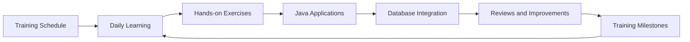

# Hexaware Training Journal

Private learning repository for tracking my Hexaware full-stack development training, exercises, database work, and daily progress.

## Training Path



## Current Project

This repository currently contains a Java 21 application that connects to MySQL using MySQL Connector/J.

```text
src/
└── com/
    ├── main/
    │   └── App.java
    ├── model/
    │   └── Employee.java
    ├── dao/
    │   └── CustomerDao.java
    ├── service/
    │   └── CustomerService.java
    └── utility/
        └── DBConnection.java
pl-sql.sql
lib/
└── mysql-connector-j-9.1.0.jar
```

## Requirements

- Java 21
- MySQL Server running on `localhost:3306`
- MySQL database named `fsd_hex_sept_2026`
- MySQL Connector/J 9.1.0

## Run the Application

From the repository root in PowerShell:

```powershell
Remove-Item -Recurse -Force .\out -ErrorAction SilentlyContinue
New-Item -ItemType Directory .\out
javac -cp ".\lib\mysql-connector-j-9.1.0.jar" -d .\out .\src\com\utility\DBConnection.java .\src\com\main\App.java
java -cp ".\out;.\lib\mysql-connector-j-9.1.0.jar" com.main.App
```

The application calls the MySQL stored procedure `all_emp()`, maps each returned row to an `Employee`, and prints the employee list through the service layer.

It also supports parameterized department procedures:

- `emp_by_department(?)` returns complete employee records for a department.
- `emp_name_by_department(?)` is the trainer's next DAO exercise and remains a placeholder in the Java code.
- `cnt_emp_by_dept(?, ?)` returns the employee count through an OUT parameter.
- `trg_check_stock_qty` validates stock before an order is inserted.
- `trg_update_product_stock_qty` decreases product stock after an order is inserted.

Run `pl-sql.sql` in the `fsd_hex_sept_2026` database before using these procedures.

Before running, create the database:

```sql
CREATE DATABASE fsd_hex_sept_2026;
```

## Training History

Daily training notes, schedules, exercises, and milestones will be added over time. Each meaningful learning milestone should be recorded with its date, topic, work completed, and follow-up action.

### 2026-09-21: Stored Procedure Employee Retrieval

- Added the `Employee` model with fields for ID, name, branch, city, and department.
- Added the `CustomerDao` data-access layer for calling `all_emp()`.
- Added the `CustomerService` layer for employee retrieval.
- Updated the application entry point to print all returned employees.
- Updated `DBConnection.dbConnect()` to return the active JDBC connection.

### 2026-09-22: Parameterized Department Procedures

- Added the trainer's validated `emp_by_department` and `emp_name_by_department` procedures.
- Added the trainer's parameterized `emp_by_department` JDBC call using `CallableStatement`.
- Added the trainer's `update_emp_branch` and `cnt_emp_by_dept` PL/SQL exercises.
- Kept `getEmployeeNamesByDepartment` as the trainer's placeholder method.
- Updated the application to demonstrate department-based retrieval.

### 2026-09-22: OUT Parameter and Views

- Added `getEmpCountByDept` using `CallableStatement` and an integer OUT parameter.
- Updated the application to display the employee count for the DEV department.
- Added the trainer's `v_emp` and `v_emp_dev` view examples with `WITH CHECK OPTION`.
- Commented the database connection status messages as shown in the trainer's commit.

### 2026-09-22: E-commerce Triggers

- Added the `product` and `orders` tables from the trainer's trigger case study.
- Added `trg_check_stock_qty` to reject invalid products and orders exceeding available stock.
- Added `trg_update_product_stock_qty` to reduce stock after a valid order.
- Added a valid sample order for product `1` with quantity `2`.

### 2026-09-22: E-commerce ER Model

- Added the MySQL Workbench model `ecom_sample.mwb`.
- Forward-engineered the `ecom_sample_db` schema with `users`, `customer`, `vendor`, `category`, `product`, and `customer_product`.
- Verified the six foreign-key relationships shown in the trainer's ER diagram.
- Prepared the forward-engineered SQL without the generated first three lines, last three lines, or `VISIBLE` keyword.

## Repository Information

- Owner: Kishore Muruganantham
- Training: Hexaware Technologies
- Language: Java
- Java version: 21
- Visibility: Private
