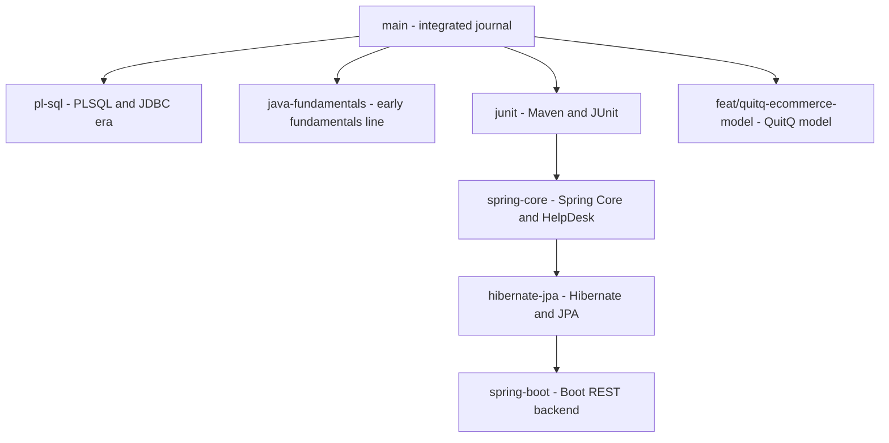

# Hexaware Training Journal

Private learning repository for tracking my Hexaware full-stack development training, exercises, database work, and daily progress. It follows the Java + React FSD training plan (program started 2026-09-21): PLSQL, Core Java 21, Maven, design principles and patterns, JUnit, Spring Core, and Hibernate/JPA are done here; each module lives on its own branch as well as in the integrated `main` history.

## Training Path

```mermaid
flowchart LR
    A[Training Schedule] --> B[Daily Learning]
    B --> C[Hands-on Exercises]
    C --> D[PLSQL and JDBC]
    D --> H[Java Fundamentals]
    H --> I[OOPs and Design Patterns]
    I --> J[Maven and JUnit]
    J --> K[Spring Core]
    K --> L[Hibernate and JPA]
    L --> E[Database Integration]
    E --> F[Reviews and Improvements]
    F --> G[Training Milestones]
    G --> B
```



## Module Plan

Taken from the training plan workbook. Status shows where each module is in this repository.

| # | Skill | Main topics | Status |
|---|-------|-------------|--------|
| 1 | PLSQL | CRUD, joins, procedures, triggers, cursors, views | Done (`main`, `pl-sql`) |
| 2 | Core Java 21 | OOP, collections, strings, date/time, JDBC, lambdas, streams | Done (`main`) |
| 3 | Maven | Repos, dependencies, build lifecycle, `pom.xml` | Done (`junit`) |
| 4 | Design principles and patterns | SOLID, Singleton, Factory | Done (`main`) |
| 5 | JUnit | Test cases, validations, exceptions, streams, DTO mapping | Done (`junit`) |
| 6 | Mockito | Mocking database/service dependencies | Upcoming |
| 7 | Spring Core | DI, beans, autowiring, JdbcTemplate, transactions | Done (`spring-core`) |
| 8 | JPA, Hibernate | ORM, session factory, mappings, HQL, criteria | Done (`hibernate-jpa`) |
| 9 | Spring MVC with Spring Boot | Controllers, views, binding, validation | Upcoming |
| 10 | Spring Batch | Batch jobs | Upcoming |
| 11 | Spring REST with Spring Boot | REST controllers, JSON, Postman, Swagger | Upcoming |
| 12 | Spring Security | OAuth2, JWT | Upcoming |
| 13 | Logging and Code Quality | Log4J, SonarQube | Upcoming |
| 14 | Microservices | Monolith to microservices, scaling | Upcoming |
| 15 | API Development | Backend case study | Upcoming |
| 16 | Demo and Technical Discussion | Final review | Upcoming |

## Branch Guide



| Branch | Holds | Trainer source | Tip |
|--------|-------|----------------|-----|
| `main` | Complete integrated journal through factory patterns | `hex_fsd_sept-2026/main` up to 2026-09-25 | `613068d` |
| `pl-sql` | PLSQL procedures, JDBC app, triggers, ER model (2026-09-21/22 state) | `hex_fsd_sept-2026/commits/pl-sql` | `3d88d2c` |
| `junit` | `MavenDemo` with JUnit tests (2026-09-28) | `hex_fsd_sept-2026/commits/junit` (5 new commits) | `165b165` |
| `spring-core` | `SpringCoreApp` DI work and `SpringCoreHelpDesk` case study (2026-09-29/30) | `hex_fsd_sept-2026/commits/spring-core` (11 new code commits) | `d13e93d` |
| `hibernate-jpa` | `HibernateJpaApp` entities, JPQL, executive and ticket flows (2026-10-01/05) | `hex_fsd_sept-2026/commits/hibernate-jpa` (9 new commits) | `f0af1aa` |
| `spring-boot` | `helpdesk_backend` Boot project with customer/executive/manager APIs (2026-10-06/07) | `hex_fsd_sept-2026/commits/spring-boot` (10 new commits) | `95edb01` |
| `java-fundamentals` | Earlier alternate fundamentals line | Same trainer fundamentals commits | `7d39d39` |
| `feat/quitq-ecommerce-model` | QuitQ e-commerce model and DDL | Course project material | `cd00b0e` |

How the data layer grows from module to module:


## Projects on `main`

This branch contains a Java 21 application that connects to MySQL using MySQL Connector/J, plus the `JavaFundamentals` exercise project.

The `JavaFundamentals` project contains the trainer's Java collections exercise. It uses enums for branch, department, and sort direction, stores sample employees in a DAO, sorts the list by salary with a lambda expression, filters by department and branch with streams, maps the model to response DTOs, groups employees by department and branch salary totals, and sorts with a default `Comparable` order. It also has the trainer's OOPs payment hierarchy demos, a singleton `DBConnection` shared by DAOs with a heap/stack demo, and a factory pattern payment demo.

```text
src/
└── com/
    ├── main/
    │   └── App.java
    ├── model/
    │   └── Employee.java
    ├── dao/
    │   └── CustomerDao.java
    ├── service/
    │   └── CustomerService.java
    └── utility/
        └── DBConnection.java
JavaFundamentals/
└── src/
    └── com/
        ├── main/
        │   ├── App.java
        │   ├── MapDemo.java
        │   ├── HeapDemo.java
        │   ├── IsADemo.java
        │   ├── NEFTPayment.java
        │   └── OOPDemo.java
        ├── model/
        │   └── Employee.java
        ├── beans/
        │   ├── Account.java
        │   ├── Current.java
        │   ├── Dmat.java
        │   ├── Savings.java
        │   ├── Payment.java
        │   ├── Neft.java
        │   ├── Upi.java
        │   └── Customer.java
        ├── dao/
        │   └── EmployeeDao.java
        ├── service/
        │   └── EmployeeService.java
        ├── enums/
        │   ├── Branch.java
        │   ├── Department.java
        │   ├── SortDirection.java
        │   └── PaymentMode.java
        ├── dto/
        │   ├── EmployeeRespDto.java
        │   ├── EmpDeptStatDto.java
        │   └── EmployeeSalaryStatDto.java
        ├── mapper/
        │   └── EmployeeMapper.java
        ├── utility/
        │   └── PaymentUtil.java
        ├── design_pattern/
        │   ├── App.java
        │   ├── DBConnection.java
        │   ├── CustomerDao.java
        │   ├── OrderDao.java
        │   └── ProductDao.java
        └── factory/
            └── design_pattern/
                ├── App.java
                ├── Payment.java
                ├── PaymentMode.java
                ├── PaymentFactory.java
                ├── Neft.java
                ├── RTGS.java
                ├── UPI.java
                ├── PhonePe.java
                ├── GooglePay.java
                └── PayTM.java
pl-sql.sql
lib/
└── mysql-connector-j-9.1.0.jar
```

## Projects on Other Branches

These live on their own branches (see the branch guide) and follow the trainer's Maven layout.

### `junit` — MavenDemo

Maven project with JUnit tests: `DemoService` validations and custom exceptions (`EmptyListException`, `InvalidInputException`, `InvalidListException`) covered by `DemoServiceTest`, plus stream operations and DTO mapping in `EmployeeService` covered by `EmployeeServiceTest`.

```text
MavenDemo/
├── pom.xml
└── src/
    ├── main/java/com/
    │   ├── service/DemoService.java
    │   ├── service/EmployeeService.java
    │   ├── model/Employee.java
    │   ├── dto/EmployeeRespDto.java
    │   ├── mapper/EmployeeMapper.java
    │   ├── enums/Branch.java
    │   ├── enums/Department.java
    │   ├── enums/SortDirection.java
    │   └── exception/EmptyListException.java
    │       ├── InvalidInputException.java
    │       └── InvalidListException.java
    └── test/java/com/service/
        ├── DemoServiceTest.java
        └── EmployeeServiceTest.java
```

### `spring-core` — SpringCoreApp and SpringCoreHelpDesk

`SpringCoreApp` walks through context loading (`AppConfig`, `App`), DAO/service beans, setter autowiring variants (`AppV2`, `AppV3`, `MyServiceV2`, `MyServiceV3` with `TestMapper` and `TestUtility`), in-method injection (`AppV4`, `MyServiceV4`), a custom bean, and a HikariCP datasource with `JdbcTemplate` (`SpringApp`). The same branch extends `pl-sql.sql` with `joining_date` and `salary` columns, seed values, and department `GROUP BY` queries for the JDBC query. `SpringCoreHelpDesk` wires the same pieces into a helpdesk app: models (`Customer`, `User`, `Ticket`), enums (`Plan`, `Priority`, `Status`, `Role`), repositories, services, `RowMapper`s (`TicketMapper`, `UserMapper`), sign-up insertion, and fetch operations with `InvalidCredentialsException`.

### `hibernate-jpa` — HibernateJpaApp

Hibernate/JPA version of the helpdesk app: `AppConfig` with the entity manager factory, transaction manager, and datasource; `Customer` entity with insert and fetch through `CustomerRepository` (JPQL) and `CustomerService`; `User` model with `Role`; and all entities (`CustomerPlan`, `Executive`, `Manager`, `Plan`, `Ticket`) with enums (`JobTitle`, `PlanType`, `Priority`, `Status`).

## Requirements

- Java 21
- MySQL Server running on `localhost:3306`
- MySQL database named `fsd_hex_sept_2026`
- MySQL Connector/J 9.1.0 (in `lib/`)
- Maven with internet access for `MavenDemo`, `SpringCoreApp`, `SpringCoreHelpDesk`, and `HibernateJpaApp` (JUnit, Spring, HikariCP, Hibernate dependencies come from their `pom.xml` files)

## Run the Applications

JDBC application on `main`, from the repository root in PowerShell:

```powershell
Remove-Item -Recurse -Force .\out -ErrorAction SilentlyContinue
New-Item -ItemType Directory .\out
javac -cp ".\lib\mysql-connector-j-9.1.0.jar" -d .\out .\src\com\utility\DBConnection.java .\src\com\main\App.java
java -cp ".\out;.\lib\mysql-connector-j-9.1.0.jar" com.main.App
```

The application calls the MySQL stored procedure `all_emp()`, maps each returned row to an `Employee`, and prints the employee list through the service layer.

It also supports parameterized department procedures:

- `emp_by_department(?)` returns complete employee records for a department.
- `emp_name_by_department(?)` is the trainer's next DAO exercise and remains a placeholder in the Java code.
- `cnt_emp_by_dept(?, ?)` returns the employee count through an OUT parameter.
- `trg_check_stock_qty` validates stock before an order is inserted.
- `trg_update_product_stock_qty` decreases product stock after an order is inserted.

Run `pl-sql.sql` in the `fsd_hex_sept_2026` database before using these procedures.

Java fundamentals exercise on `main` (no database needed):

```powershell
Remove-Item -Recurse -Force .\out-fund -ErrorAction SilentlyContinue
New-Item -ItemType Directory .\out-fund
javac -d .\out-fund .\JavaFundamentals\src\com\enums\*.java .\JavaFundamentals\src\com\model\*.java .\JavaFundamentals\src\com\dao\*.java .\JavaFundamentals\src\com\dto\*.java .\JavaFundamentals\src\com\mapper\*.java .\JavaFundamentals\src\com\service\*.java .\JavaFundamentals\src\com\main\*.java
java -cp .\out-fund com.main.App
```

The application loads the sample employees from `EmployeeDao`, maps each one to an `EmployeeRespDto` with `EmployeeMapper`, and prints the DTO list. Sorting by salary, filtering by department and branch, and listing employee names are kept in the commented block in `App.java` as shown in the trainer's commit.

Other demo entry points in the same project:

```powershell
java -cp .\out-fund com.main.MapDemo
java -cp .\out-fund com.main.OOPDemo
java -cp .\out-fund com.main.IsADemo
java -cp .\out-fund com.main.HeapDemo
java -cp .\out-fund com.design_pattern.App
java -cp .\out-fund com.factory.design_pattern.App
```

`MapDemo` shows basic `HashMap` put, get, and entry-set printing. `OOPDemo` and `IsADemo` show the trainer's polymorphism and payment examples. `HeapDemo` shows heap references and the stack comment from the trainer. `com.design_pattern.App` shows the singleton `DBConnection` shared by the three DAOs. `com.factory.design_pattern.App` shows payment creation through `PaymentFactory`.

Maven projects on their branches (needs Maven):

```powershell
cd MavenDemo
mvn test
```

```powershell
cd SpringCoreApp
mvn compile exec:java -Dexec.mainClass="com.main.App"
```

```powershell
cd SpringCoreHelpDesk
mvn compile exec:java -Dexec.mainClass="com.helpdesk.main.App"
```

```powershell
cd HibernateJpaApp
mvn compile exec:java -Dexec.mainClass="com.helpdesk.main.App"
```

The Spring and Hibernate apps additionally need MySQL running with the `fsd_hex_sept_2026` database from the updated `pl-sql.sql` on the `spring-core` branch (it adds the `joining_date` and `salary` columns).

Before running, create the database:

```sql
CREATE DATABASE fsd_hex_sept_2026;
```

## Validation Summary

| Project | Branch | Checks | Result |
|---------|--------|--------|--------|
| JDBC `src/` app | `main`, `pl-sql` | `javac` Java 21, MySQL reachable | BUILD_EXIT=0 |
| `JavaFundamentals` | `main` | `javac` Java 21, ran all 7 demo entry points | BUILD_EXIT=0, RUN_EXIT=0 |
| `MavenDemo` main sources | `junit` | `javac` Java 21 (JDK-only imports) | MAIN_BUILD_EXIT=0 |
| `MavenDemo` tests | `junit` | `mvn test` | Not run here (no Maven/JUnit jars) |
| `SpringCoreApp` | `spring-core` | `javac` Java 21 | Only missing Spring/HikariCP package errors, no syntax errors; run needs Maven, jars, MySQL |
| `SpringCoreHelpDesk` | `spring-core` | `javac` Java 21 | Only missing Spring/HikariCP package errors, no syntax errors; run needs Maven, jars, MySQL |
| `HibernateJpaApp` | `hibernate-jpa` | `javac` Java 21 | Only missing JPA/Spring/Hibernate package errors, no syntax errors; run needs Maven, jars, MySQL |
| All `pom.xml` files | branches | XML well-formed | Passed |

## Training History

Daily training notes, schedules, exercises, and milestones will be added over time. Each meaningful learning milestone should be recorded with its date, topic, work completed, and follow-up action.

### 2026-09-21

Commits: `48297b1` Initialize Hexaware training journal; `9d89488` Add employee stored procedure retrieval.

**Stored Procedure Employee Retrieval**

- Added the `Employee` model with fields for ID, name, branch, city, and department.
- Added the `CustomerDao` data-access layer for calling `all_emp()`.
- Added the `CustomerService` layer for employee retrieval.
- Updated the application entry point to print all returned employees.
- Updated `DBConnection.dbConnect()` to return the active JDBC connection.

### 2026-09-22

Commits: `976ad6f` Add parameterized department procedures; `f88e5f3` Align training exercises with trainer commits; `82ccd94` Remove unused database connection variable; `1caa3c0` Add employee count and views; `e4426f3` Add product stock triggers; `3d88d2c` Add e-commerce ER model.

**Parameterized Department Procedures**

- Added the trainer's validated `emp_by_department` and `emp_name_by_department` procedures.
- Added the trainer's parameterized `emp_by_department` JDBC call using `CallableStatement`.
- Added the trainer's `update_emp_branch` and `cnt_emp_by_dept` PL/SQL exercises.
- Kept `getEmployeeNamesByDepartment` as the trainer's placeholder method.
- Updated the application to demonstrate department-based retrieval.

**OUT Parameter and Views**

- Added `getEmpCountByDept` using `CallableStatement` and an integer OUT parameter.
- Updated the application to display the employee count for the DEV department.
- Added the trainer's `v_emp` and `v_emp_dev` view examples with `WITH CHECK OPTION`.
- Commented the database connection status messages as shown in the trainer's commit.

**E-commerce Triggers**

- Added the `product` and `orders` tables from the trainer's trigger case study.
- Added `trg_check_stock_qty` to reject invalid products and orders exceeding available stock.
- Added `trg_update_product_stock_qty` to reduce stock after a valid order.
- Added a valid sample order for product `1` with quantity `2`.

**E-commerce ER Model**

- Added the MySQL Workbench model `ecom_sample.mwb`.
- Forward-engineered the `ecom_sample_db` schema with `users`, `customer`, `vendor`, `category`, `product`, and `customer_product`.
- Verified the six foreign-key relationships shown in the trainer's ER diagram.
- Prepared the forward-engineered SQL without the generated first three lines, last three lines, or `VISIBLE` keyword.

### 2026-09-23

Commits: `90cf076` Add Java fundamentals collections and DTO mapping; `1422710` Correct release version to 0.8.9.

**Java Fundamentals Collections and DTO Mapping**

- Added the `JavaFundamentals` project with `Branch`, `Department`, and `SortDirection` enums.
- Added the `Employee` model with branch, department, joining date, and salary fields.
- Added `EmployeeDao` with 20 sample employees.
- Added `EmployeeService` with salary sorting using a lambda expression, stream filters by department and branch, employee name listing, and model-to-DTO mapping.
- Added the `EmployeeRespDto` record and `EmployeeMapper` for model-to-DTO conversion.
- Added the `App` starter class which prints the DTO list; sorting, filtering, and name listing are kept in the commented block as shown in the trainer's commit.
- Added Java project metadata (`JavaFundamentals.iml`, `.idea` files, `.gitignore`) so `JavaFundamentals` opens as its own IntelliJ project.
- Verified with `javac` on Java 21 (BUILD_EXIT=0) and `java com.main.App` (RUN_EXIT=0); the app printed all 20 `EmployeeRespDto` records.
- MySQL server on `localhost:3306` was reachable; the fundamentals exercise itself does not need a database.
- Known issue: none; the salary sort uses the trainer's `(int)` cast comparison.

### 2026-09-24

Commits: `4725f2b` Add grouping employees by department; `1d4f11d` Add map to DTO conversion with Map demo; `a75ff1f` Add salary grouping by branch with total sum; `2779d85` Add Comparable default sort by joining date; `89f3cd3` Add OOPs concepts with payment hierarchy; `c1b4d37` Update journal for grouping, DTO stats, Comparable and OOPs training.

**Grouping, DTO Stats, Comparable, and OOPs**

- Added `EmpDeptStatDto` and `getEmpCountForEachDepartment` grouping with `Collectors.groupingBy` and `Collectors.counting`.
- Added `MapDemo` with the trainer's `HashMap` login example.
- Converted the department count to a `List<EmpDeptStatDto>` through entry-set mapping.
- Added `EmployeeSalaryStatDto`, `getSalaryOfEachEmpByBranch` with `Collectors.summingDouble`, and `computeTotalSalary`.
- Added `Comparable` to `Employee` with joining-date default sort and sorted retrieval in `getAllEmployees`.
- Added the trainer's OOPs payment hierarchy (`Account`, `Savings`, `Current`, `Dmat`, `Payment`, `Neft`, `Upi`), `PaymentMode` enum, `PaymentUtil`, and the `OOPDemo`, `IsADemo`, and `NEFTPayment` starters.
- Verified with `javac` on Java 21 (BUILD_EXIT=0); `App` printed the department stats, branch salary stats, and total salary 1680000.0; `MapDemo`, `OOPDemo`, and `IsADemo` ran (RUN_EXIT=0).
- Known issue: none; kept the trainer's style and comments as shown.

### 2026-09-25

Commits: `5138f41` Add Singleton pattern with heap and stack demo; `da77d71` Add factory pattern for payments; `613068d` Update journal for Singleton and factory pattern training.

**Singleton and Factory Patterns**

- Added the `Customer` bean and the trainer's singleton `DBConnection` shared by `CustomerDao`, `OrderDao`, and `ProductDao` in `com.design_pattern`.
- Added `HeapDemo` showing heap object references and the trainer's stack and garbage-collector comments.
- Added the trainer's factory pattern in `com.factory.design_pattern` (`Payment`, `PaymentMode`, `PaymentFactory`, `Neft`, `RTGS`, `UPI`, `PhonePe`, `GooglePay`, `PayTM`) with its `App` starter.
- Verified with `javac` on Java 21 (BUILD_EXIT=0); `HeapDemo`, `com.design_pattern.App` (same connection instance in all DAOs), and `com.factory.design_pattern.App` (charge 10.0, limit 200000.0) ran (RUN_EXIT=0).
- Known issue: none; kept the trainer's style and comments as shown.

### 2026-09-28

Commits (branch `junit`): `8851402` Add Maven project setup with JUnit dependencies; `0de9be7` Add first test case for demo service; `a3b7930` Add test case with validations and exceptions; `c72118f` Add stream test cases for employee service; `9e05f28` Add DTO test case with mapper; `165b165` Update journal for Maven and JUnit training.

**Maven and JUnit Tests** (branch `junit`)

- Added the `MavenDemo` Maven project with JUnit dependencies, `DemoService` validations and exceptions, stream test cases, and DTO mapper test cases.
- Verified `pom.xml` is well-formed and main sources compile with `javac` on Java 21; `mvn test` needs Maven and the JUnit jars, which are not installed here.
- Released as `v0.11.0` on the `junit` branch.

### 2026-09-29

Commits (branch `spring-core`): `0013596` Add Spring app setup with employee salary columns; `a15cdb3` Load Spring app with AppConfig; `af076c1` Add DAO and service classes to Spring context; `b0f549a` Add autowiring with setter injection variants; `1c9c63a` Add in-method direct injection; `6b378f1` Add custom bean definition; `eb160fa` Add datasource and JdbcTemplate config; `518ed01` Update journal for Spring Core training.

**Spring Core Dependency Injection** (branch `spring-core`)

- Added `SpringCoreApp` with `AppConfig`, DAO/service beans, setter autowiring variants, in-method injection, custom bean, and HikariCP datasource with `JdbcTemplate`.
- Extended `pl-sql.sql` with `joining_date`/`salary` columns, seed values, and `GROUP BY` queries.
- `javac` on Java 21 shows only missing Spring/HikariCP dependency errors; running needs Maven, jars, and MySQL.
- Released as `v0.12.0` on the `spring-core` branch.

### 2026-09-30

Commits (branch `spring-core`): `b70c973` Add HelpDesk project setup with models; `61d618d` Add HelpDesk models, repositories and services; `c207393` Add customer sign up insertion; `86facdf` Add fetch operations with mappers; `d13e93d` Update journal for HelpDesk case study.

**HelpDesk Case Study** (branch `spring-core`)

- Added `SpringCoreHelpDesk` with models, enums, repositories, services, sign-up insertion, and fetch operations with mappers.
- `javac` on Java 21 shows only missing Spring/HikariCP dependency errors; running needs Maven, jars, and MySQL.
- Released as `v0.13.0` on the `spring-core` branch.

### 2026-10-01

Commits (branch `hibernate-jpa`): `b4cf2d7` Add Hibernate app initial config; `4beb80e` Add Hibernate config with Customer entity; `cd3bfa1` Add insert and fetch with JPQL repository; `cfcb1c9` Add User model with roles; `5804b7c` Add all helpdesk entities; `1897717` Update journal for Hibernate and JPA training.

**Hibernate and JPA Entities** (branch `hibernate-jpa`)

- Added `HibernateJpaApp` with `AppConfig`, `Customer` entity and JPQL repository, `User` model, and all helpdesk entities with enums.
- `javac` on Java 21 shows only missing JPA/Spring/Hibernate dependency errors; running needs Maven, jars, and MySQL.
- Released as `v0.14.0` on the `hibernate-jpa` branch.

### 2026-10-02

Commits: `dbab042` Consolidate journal README with full training details.

**Journal Consolidation**

- Rewrote this README with the full module plan from the training workbook, the branch guide, per-branch project structure, run commands, and the validation summary.
- No source code was changed; all training content and dates are untouched.
- Known issue: none.

### 2026-10-05

Commits (branch `hibernate-jpa`): `9c1fab1` Add executive insert with service and repository; `91707e0` Update journal for executive insert training; `656713a` Add full executive insert with user flow; `554edb4` Update journal for executive user flow training; `43e99f5` Add ticket creation with customer flow; `a30c336` Update journal for ticket creation training; `a7fd88c` Add ticket fetch with DTO mapping; `f0af1aa` Update journal for ticket fetch training. Commits (`main`): `a00c2fa`, `9858acf`, `5261178` README merges; `19f0b1d` add simple-library-system Task 1 reference.

**Executive Insert** (branch `hibernate-jpa`)

- Added `ExecutiveService` with the trainer's step-commented `insertExecutive`, `ExecutiveRepository`, `ExecutiveController` starter, restructured datasource bean, and the `helpdesk.mwb` model.
- Added the full user flow: manager validation, user persist with JPQL re-fetch, and executive persist.
- Code and journal live on the `hibernate-jpa` branch; only this README entry is merged here.
- Released as `v0.15.0` and `v0.16.0` on the `hibernate-jpa` branch.

**Ticket Creation With Customer** (branch `hibernate-jpa`)

- Added `TicketService` with step-commented `insertTicket`, `TicketRepository`, `TicketController` starter, customer lookup, and model updates.
- Seeded the `helpdesk_v2` customer row with the trainer's statement (`insert into customer(city,name) values ('london','harry potter');`).
- Code and journal live on the `hibernate-jpa` branch; only this README entry is merged here.
- Released as `v0.17.0` on the `hibernate-jpa` branch.

**Ticket Fetch With DTO** (branch `hibernate-jpa`)

- Added `TicketRespDto` and `TicketMapper`, V1/V2 fetch queries, `fetchTicketInfo` service, and the controller fetch demo.
- Code and journal live on the `hibernate-jpa` branch; only this README entry is merged here.
- Released as `v0.18.0` on the `hibernate-jpa` branch.

### 2026-10-06

Commits (branch `spring-boot`): `fb6f234` Add Spring Boot helpdesk backend with customer POST API; `20067cb` Update journal for Spring Boot backend training; `5857616` Add basic CRUD APIs for customer; `8d80e10` Update journal for customer CRUD APIs training; `5750a19` Add global handler for invalid IDs; `4a84739` Update journal for global handler training; `23dbee5` Add error DTO response with ResponseEntity; `b0d8558` Update journal for error DTO training. Commits (`main`): `96cdb49`, `f648ef0`, `e2996da`, `1e81984` README merges.

**Spring Boot Customer POST API** (branch `spring-boot`)

- Added the trainer's `helpdesk_backend` Spring Boot 3.5.16 project with customer POST API, verified booting on port 8080 with a live POST returning HTTP 200.
- Code and journal live on the `spring-boot` branch; only this README entry is merged here.
- Released as `v0.19.0` on the `spring-boot` branch.

**Customer CRUD APIs** (branch `spring-boot`)

- Added `GET /api/customer/all`, `GET /api/customer/{id}`, and `DELETE /api/customer/{id}` with `ResourceNotFoundException` for bad ids.
- Exercised all four endpoints live: GET all 200, GET one 200, POST 200, DELETE 200, and GET-after-delete reproduces the trainer's 500 JSON (his exception carries no status mapping, kept as written).
- Code and journal live on the `spring-boot` branch; only this README entry is merged here.
- Released as `v0.20.0` on the `spring-boot` branch.

**Global Handler for Invalid IDs** (branch `spring-boot`)

- Added `GlobalExceptionHandler` mapping invalid ids to 400 with the message; delete validates first.
- Rebooted and exercised live: valid ids 200, missing ids 400 with `Invalid customer id`.
- Code and journal live on the `spring-boot` branch; only this README entry is merged here.
- Released as `v0.21.0` on the `spring-boot` branch.

**Error DTO Response** (branch `spring-boot`)

- Added `ErrorDto` record with `ResponseEntity`, fulfilling his "always reply the object not the string" comment; missing ids now return 400 with the DTO instead of 500 JSON.
- Verified live after reboot on the branch.
- Code and journal live on the `spring-boot` branch; only this README entry is merged here.
- Released as `v0.22.0` on the `spring-boot` branch.

### 2026-10-07

Commits (branch `spring-boot`): `7d43b8a` Add executive POST API with validation; `09a15b0` Update journal for executive validation training; `b507731` Refine validation errors to field message map; `875e0a1` Update journal for validation refinement training; `175dabb` Add executive POST with linked user; `579a450` Update journal for executive user training; `45bff13` Add manager POST with connected executive flow; `a267e97` Update journal for manager flow training; `fd9bb06` Add customer POST with user scaffolding; `09b0606` Add customer POST API with linked user; `95edb01` Update journal for customer user training.

**Executive POST API With Validation** (branch `spring-boot`)

- Added `ExecutiveDto` with bean validations, mapper, entity, repository, service, and `POST /api/executive/add`; verified live (valid 200 with saved record, invalid 400 with field messages).
- Code and journal live on the `spring-boot` branch; only this README entry is merged here.
- Released as `v0.23.0` on the `spring-boot` branch.

**Validation Errors Refined to Field Map** (branch `spring-boot`)

- Added `ExecutiveDto` with bean validations, mapper, entity, repository, service, and `POST /api/executive/add`; refined errors to a field-to-message map with corrected contact messages.
- Verified live on the branch (valid 200 with saved record, invalid 400 with the field map).
- Code and journal live on the `spring-boot` branch; only this README entry is merged here.
- Released as `v0.24.0` on the `spring-boot` branch.

**Executive POST With Linked User** (branch `spring-boot`)

- Added `User` entity, `Role` enum, `UserRepository`, and `UserService`; the executive POST now persists the user first and returns the executive with its managed user attached.
- Verified live on the branch (valid 200 carrying the persisted user, invalid 400 with the field map).
- Code and journal live on the `spring-boot` branch; only this README entry is merged here.
- Released as `v0.25.0` on the `spring-boot` branch.

**Manager POST With Connected Executive** (branch `spring-boot`)

- Added `Manager` entity, `ManagerDto`, `ManagerMapper`, `ManagerRepository`, and `ManagerService` with linked-user creation; executive POST takes the manager id from the path with validation.
- Verified live on the branch (manager 200, executive with valid manager 200, bad manager 400).
- Code and journal live on the `spring-boot` branch; only this README entry is merged here.
- Released as `v0.26.0` on the `spring-boot` branch.

**Customer POST With Linked User** (branch `spring-boot`)

- Added `CustomerDto`, `CustomerMapper`, and the user link on `Customer`; the customer POST persists the user first and returns the customer with its managed user attached.
- Verified live on the branch (customer POST 200 carrying the persisted user).
- Code and journal live on the `spring-boot` branch; only this README entry is merged here.
- Released as `v0.27.0` on the `spring-boot` branch.

## Known Issues and Limits

- The salary sort in `JavaFundamentals` uses the trainer's `(int)` cast comparison, kept as shown.
- `emp_name_by_department(?)` remains a placeholder in the Java code, as in the trainer's commit.
- Maven projects (`MavenDemo`, `SpringCoreApp`, `SpringCoreHelpDesk`, `HibernateJpaApp`) need Maven with internet access plus MySQL where noted; this environment has no Maven, so their tests and runs are recorded as not run here.
- Trainer reference PDFs (project briefs, case study) are intentionally not stored in this repository.

## Release History

Release notes live in `RELEASE_NOTES.md`, organized by date and version: `v0.8.9`–`v0.10.0` on `main`, `v0.11.0` on `junit`, `v0.12.0`–`v0.13.0` on `spring-core`, `v0.14.0` on `hibernate-jpa`.

## Repository Information

- Owner: Kishore Muruganantham
- Training: Hexaware Technologies
- Language: Java
- Java version: 21
- Branches: `main`, `pl-sql`, `junit`, `spring-core`, `hibernate-jpa`, `spring-boot`, `java-fundamentals`, `feat/quitq-ecommerce-model`
- Visibility: Private

## Case Study Projects

- **simple-library-system** (Task 1 - Basic CRUD): https://github.com/KishoreMuruganantham/simple-library-system — pure Java 21 + JDBC, MySQL, DriverManager, PreparedStatement, manual ResultSet mapping, 3 entities (Author, Member, Book), 9 DAO methods, enums, service layer with step comments, library.sql + library.mwb
