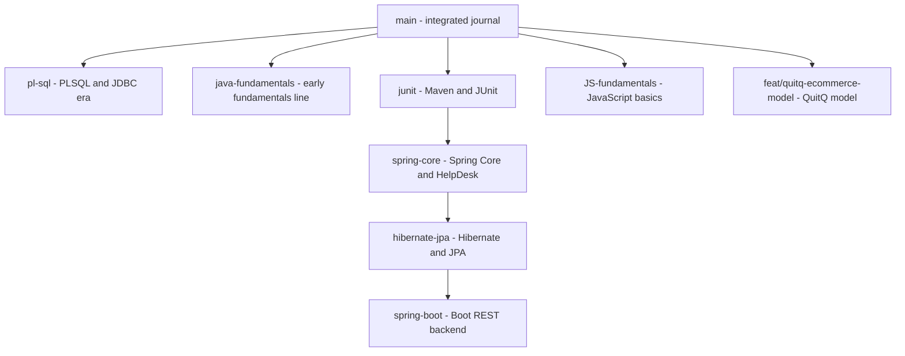

# Hexaware Training Journal

Private learning repository for tracking my Hexaware full-stack development training, exercises, database work, and daily progress. It follows the Java + React FSD training plan (program started 2026-09-21): PLSQL, Core Java 21, Maven, design principles and patterns, JUnit, Spring Core, and Hibernate/JPA are done here; each module lives on its own branch as well as in the integrated `main` history.

## Training Path

```mermaid
flowchart LR
    A[Training Schedule] --> B[Daily Learning]
    B --> C[Hands-on Exercises]
    C --> D[PLSQL and JDBC]
    D --> H[Java Fundamentals]
    H --> I[OOPs and Design Patterns]
    I --> J[Maven and JUnit]
    J --> K[Spring Core]
    K --> L[Hibernate and JPA]
    L --> E[Database Integration]
    E --> F[Reviews and Improvements]
    F --> G[Training Milestones]
    G --> B
```



## Module Plan

Taken from the training plan workbook. Status shows where each module is in this repository.

| # | Skill | Main topics | Status |
|---|-------|-------------|--------|
| 1 | PLSQL | CRUD, joins, procedures, triggers, cursors, views | Done (`main`, `pl-sql`) |
| 2 | Core Java 21 | OOP, collections, strings, date/time, JDBC, lambdas, streams | Done (`main`) |
| 3 | Maven | Repos, dependencies, build lifecycle, `pom.xml` | Done (`junit`) |
| 4 | Design principles and patterns | SOLID, Singleton, Factory | Done (`main`) |
| 5 | JUnit | Test cases, validations, exceptions, streams, DTO mapping | Done (`junit`) |
| 6 | Mockito | Mocking database/service dependencies | Upcoming |
| 7 | Spring Core | DI, beans, autowiring, JdbcTemplate, transactions | Done (`spring-core`) |
| 8 | JPA, Hibernate | ORM, session factory, mappings, HQL, criteria | Done (`hibernate-jpa`) |
| 9 | Spring MVC with Spring Boot | Controllers, views, binding, validation | Upcoming |
| 10 | Spring Batch | Batch jobs | Upcoming |
| 11 | Spring REST with Spring Boot | REST controllers, JSON, Postman, Swagger | Upcoming |
| 12 | Spring Security | OAuth2, JWT | Upcoming |
| 13 | Logging and Code Quality | Log4J, SonarQube | Upcoming |
| 14 | Microservices | Monolith to microservices, scaling | Upcoming |
| 15 | API Development | Backend case study | Upcoming |
| 16 | Demo and Technical Discussion | Final review | Upcoming |

## Branch Guide



| Branch | Holds | Trainer source | Tip |
|--------|-------|----------------|-----|
| `main` | Complete integrated journal through factory patterns | `hex_fsd_sept-2026/main` up to 2026-09-25 | `613068d` |
| `pl-sql` | PLSQL procedures, JDBC app, triggers, ER model (2026-09-21/22 state) | `hex_fsd_sept-2026/commits/pl-sql` | `3d88d2c` |
| `junit` | `MavenDemo` with JUnit tests (2026-09-28) | `hex_fsd_sept-2026/commits/junit` (5 new commits) | `165b165` |
| `spring-core` | `SpringCoreApp` DI work and `SpringCoreHelpDesk` case study (2026-09-29/30) | `hex_fsd_sept-2026/commits/spring-core` (11 new code commits) | `d13e93d` |
| `hibernate-jpa` | `HibernateJpaApp` entities, JPQL, executive and ticket flows (2026-10-01/05) | `hex_fsd_sept-2026/commits/hibernate-jpa` (9 new commits) | `f0af1aa` |
| `spring-boot` | `helpdesk_backend` Boot project with ticket and plan APIs, plus the ticket search case study (2026-10-06/25) | `hex_fsd_sept-2026/commits/spring-boot` + `imtiyaz-hirani/helpdesk_backend` (35 new commits) | `4e03e6a` |
| `JS-fundamentals` | `js-fundamentals` Node project with fundamentals, arrays, map/reduce, and the `learning-app` case study (2026-10-23/25) | `hex_fsd_sept-2026/commits/JS-fundamentals` (4 new commits) | `139e9e0` |
| `react` | `react-ui` Vite + React 19 app: layout, forms with state, course list CRUD, users case study, React Router navigation, and the posts GET/POST API (2026-10-26/28) | `hex_fsd_sept-2026/commits/react` (13 new commits) | `96062d9` |
| `helpdesk-ui` | `helpdesk-ui` Vite + React 19 app: router, HTTP Basic login against `helpdesk_backend`, sign up and 404 stubs (2026-10-28) | `hex_fsd_sept-2026/commits/helpdesk-ui` (3 new commits) | `0100259` |
| `java-fundamentals` | Earlier alternate fundamentals line | Same trainer fundamentals commits | `7d39d39` |
| `feat/quitq-ecommerce-model` | QuitQ e-commerce model and DDL | Course project material | `cd00b0e` |

How the data layer grows from module to module:


## Projects on `main`

This branch contains a Java 21 application that connects to MySQL using MySQL Connector/J, plus the `JavaFundamentals` exercise project.

The `JavaFundamentals` project contains the trainer's Java collections exercise. It uses enums for branch, department, and sort direction, stores sample employees in a DAO, sorts the list by salary with a lambda expression, filters by department and branch with streams, maps the model to response DTOs, groups employees by department and branch salary totals, and sorts with a default `Comparable` order. It also has the trainer's OOPs payment hierarchy demos, a singleton `DBConnection` shared by DAOs with a heap/stack demo, and a factory pattern payment demo.

```text
src/
└── com/
    ├── main/
    │   └── App.java
    ├── model/
    │   └── Employee.java
    ├── dao/
    │   └── CustomerDao.java
    ├── service/
    │   └── CustomerService.java
    └── utility/
        └── DBConnection.java
JavaFundamentals/
└── src/
    └── com/
        ├── main/
        │   ├── App.java
        │   ├── MapDemo.java
        │   ├── HeapDemo.java
        │   ├── IsADemo.java
        │   ├── NEFTPayment.java
        │   └── OOPDemo.java
        ├── model/
        │   └── Employee.java
        ├── beans/
        │   ├── Account.java
        │   ├── Current.java
        │   ├── Dmat.java
        │   ├── Savings.java
        │   ├── Payment.java
        │   ├── Neft.java
        │   ├── Upi.java
        │   └── Customer.java
        ├── dao/
        │   └── EmployeeDao.java
        ├── service/
        │   └── EmployeeService.java
        ├── enums/
        │   ├── Branch.java
        │   ├── Department.java
        │   ├── SortDirection.java
        │   └── PaymentMode.java
        ├── dto/
        │   ├── EmployeeRespDto.java
        │   ├── EmpDeptStatDto.java
        │   └── EmployeeSalaryStatDto.java
        ├── mapper/
        │   └── EmployeeMapper.java
        ├── utility/
        │   └── PaymentUtil.java
        ├── design_pattern/
        │   ├── App.java
        │   ├── DBConnection.java
        │   ├── CustomerDao.java
        │   ├── OrderDao.java
        │   └── ProductDao.java
        └── factory/
            └── design_pattern/
                ├── App.java
                ├── Payment.java
                ├── PaymentMode.java
                ├── PaymentFactory.java
                ├── Neft.java
                ├── RTGS.java
                ├── UPI.java
                ├── PhonePe.java
                ├── GooglePay.java
                └── PayTM.java
pl-sql.sql
lib/
└── mysql-connector-j-9.1.0.jar
```

## Projects on Other Branches

These live on their own branches (see the branch guide) and follow the trainer's Maven layout.

### `junit` — MavenDemo

Maven project with JUnit tests: `DemoService` validations and custom exceptions (`EmptyListException`, `InvalidInputException`, `InvalidListException`) covered by `DemoServiceTest`, plus stream operations and DTO mapping in `EmployeeService` covered by `EmployeeServiceTest`.

```text
MavenDemo/
├── pom.xml
└── src/
    ├── main/java/com/
    │   ├── service/DemoService.java
    │   ├── service/EmployeeService.java
    │   ├── model/Employee.java
    │   ├── dto/EmployeeRespDto.java
    │   ├── mapper/EmployeeMapper.java
    │   ├── enums/Branch.java
    │   ├── enums/Department.java
    │   ├── enums/SortDirection.java
    │   └── exception/EmptyListException.java
    │       ├── InvalidInputException.java
    │       └── InvalidListException.java
    └── test/java/com/service/
        ├── DemoServiceTest.java
        └── EmployeeServiceTest.java
```

### `spring-core` — SpringCoreApp and SpringCoreHelpDesk

`SpringCoreApp` walks through context loading (`AppConfig`, `App`), DAO/service beans, setter autowiring variants (`AppV2`, `AppV3`, `MyServiceV2`, `MyServiceV3` with `TestMapper` and `TestUtility`), in-method injection (`AppV4`, `MyServiceV4`), a custom bean, and a HikariCP datasource with `JdbcTemplate` (`SpringApp`). The same branch extends `pl-sql.sql` with `joining_date` and `salary` columns, seed values, and department `GROUP BY` queries for the JDBC query. `SpringCoreHelpDesk` wires the same pieces into a helpdesk app: models (`Customer`, `User`, `Ticket`), enums (`Plan`, `Priority`, `Status`, `Role`), repositories, services, `RowMapper`s (`TicketMapper`, `UserMapper`), sign-up insertion, and fetch operations with `InvalidCredentialsException`.

### `hibernate-jpa` — HibernateJpaApp

Hibernate/JPA version of the helpdesk app: `AppConfig` with the entity manager factory, transaction manager, and datasource; `Customer` entity with insert and fetch through `CustomerRepository` (JPQL) and `CustomerService`; `User` model with `Role`; and all entities (`CustomerPlan`, `Executive`, `Manager`, `Plan`, `Ticket`) with enums (`JobTitle`, `PlanType`, `Priority`, `Status`).

## Requirements

- Java 21
- MySQL Server running on `localhost:3306`
- MySQL database named `fsd_hex_sept_2026`
- MySQL Connector/J 9.1.0 (in `lib/`)
- Maven with internet access for `MavenDemo`, `SpringCoreApp`, `SpringCoreHelpDesk`, and `HibernateJpaApp` (JUnit, Spring, HikariCP, Hibernate dependencies come from their `pom.xml` files)

## Run the Applications

JDBC application on `main`, from the repository root in PowerShell:

```powershell
Remove-Item -Recurse -Force .\out -ErrorAction SilentlyContinue
New-Item -ItemType Directory .\out
javac -cp ".\lib\mysql-connector-j-9.1.0.jar" -d .\out .\src\com\utility\DBConnection.java .\src\com\main\App.java
java -cp ".\out;.\lib\mysql-connector-j-9.1.0.jar" com.main.App
```

The application calls the MySQL stored procedure `all_emp()`, maps each returned row to an `Employee`, and prints the employee list through the service layer.

It also supports parameterized department procedures:

- `emp_by_department(?)` returns complete employee records for a department.
- `emp_name_by_department(?)` is the trainer's next DAO exercise and remains a placeholder in the Java code.
- `cnt_emp_by_dept(?, ?)` returns the employee count through an OUT parameter.
- `trg_check_stock_qty` validates stock before an order is inserted.
- `trg_update_product_stock_qty` decreases product stock after an order is inserted.

Run `pl-sql.sql` in the `fsd_hex_sept_2026` database before using these procedures.

Java fundamentals exercise on `main` (no database needed):

```powershell
Remove-Item -Recurse -Force .\out-fund -ErrorAction SilentlyContinue
New-Item -ItemType Directory .\out-fund
javac -d .\out-fund .\JavaFundamentals\src\com\enums\*.java .\JavaFundamentals\src\com\model\*.java .\JavaFundamentals\src\com\dao\*.java .\JavaFundamentals\src\com\dto\*.java .\JavaFundamentals\src\com\mapper\*.java .\JavaFundamentals\src\com\service\*.java .\JavaFundamentals\src\com\main\*.java
java -cp .\out-fund com.main.App
```

The application loads the sample employees from `EmployeeDao`, maps each one to an `EmployeeRespDto` with `EmployeeMapper`, and prints the DTO list. Sorting by salary, filtering by department and branch, and listing employee names are kept in the commented block in `App.java` as shown in the trainer's commit.

Other demo entry points in the same project:

```powershell
java -cp .\out-fund com.main.MapDemo
java -cp .\out-fund com.main.OOPDemo
java -cp .\out-fund com.main.IsADemo
java -cp .\out-fund com.main.HeapDemo
java -cp .\out-fund com.design_pattern.App
java -cp .\out-fund com.factory.design_pattern.App
```

`MapDemo` shows basic `HashMap` put, get, and entry-set printing. `OOPDemo` and `IsADemo` show the trainer's polymorphism and payment examples. `HeapDemo` shows heap references and the stack comment from the trainer. `com.design_pattern.App` shows the singleton `DBConnection` shared by the three DAOs. `com.factory.design_pattern.App` shows payment creation through `PaymentFactory`.

Maven projects on their branches (needs Maven):

```powershell
cd MavenDemo
mvn test
```

```powershell
cd SpringCoreApp
mvn compile exec:java -Dexec.mainClass="com.main.App"
```

```powershell
cd SpringCoreHelpDesk
mvn compile exec:java -Dexec.mainClass="com.helpdesk.main.App"
```

```powershell
cd HibernateJpaApp
mvn compile exec:java -Dexec.mainClass="com.helpdesk.main.App"
```

The Spring and Hibernate apps additionally need MySQL running with the `fsd_hex_sept_2026` database from the updated `pl-sql.sql` on the `spring-core` branch (it adds the `joining_date` and `salary` columns).

Before running, create the database:

```sql
CREATE DATABASE fsd_hex_sept_2026;
```

## Validation Summary

| Project | Branch | Checks | Result |
|---------|--------|--------|--------|
| JDBC `src/` app | `main`, `pl-sql` | `javac` Java 21, MySQL reachable | BUILD_EXIT=0 |
| `JavaFundamentals` | `main` | `javac` Java 21, ran all 7 demo entry points | BUILD_EXIT=0, RUN_EXIT=0 |
| `MavenDemo` main sources | `junit` | `javac` Java 21 (JDK-only imports) | MAIN_BUILD_EXIT=0 |
| `MavenDemo` tests | `junit` | `mvn test` | Not run here (no Maven/JUnit jars) |
| `SpringCoreApp` | `spring-core` | `javac` Java 21 | Only missing Spring/HikariCP package errors, no syntax errors; run needs Maven, jars, MySQL |
| `SpringCoreHelpDesk` | `spring-core` | `javac` Java 21 | Only missing Spring/HikariCP package errors, no syntax errors; run needs Maven, jars, MySQL |
| `HibernateJpaApp` | `hibernate-jpa` | `javac` Java 21 | Only missing JPA/Spring/Hibernate package errors, no syntax errors; run needs Maven, jars, MySQL |
| All `pom.xml` files | branches | XML well-formed | Passed |

## Training History

Daily training notes, schedules, exercises, and milestones will be added over time. Each meaningful learning milestone should be recorded with its date, topic, work completed, and follow-up action.

### 2026-09-21

Commits: `48297b1` Initialize Hexaware training journal; `9d89488` Add employee stored procedure retrieval.

**Stored Procedure Employee Retrieval**

- Added the `Employee` model with fields for ID, name, branch, city, and department.
- Added the `CustomerDao` data-access layer for calling `all_emp()`.
- Added the `CustomerService` layer for employee retrieval.
- Updated the application entry point to print all returned employees.
- Updated `DBConnection.dbConnect()` to return the active JDBC connection.

### 2026-09-22

Commits: `976ad6f` Add parameterized department procedures; `f88e5f3` Align training exercises with trainer commits; `82ccd94` Remove unused database connection variable; `1caa3c0` Add employee count and views; `e4426f3` Add product stock triggers; `3d88d2c` Add e-commerce ER model.

**Parameterized Department Procedures**

- Added the trainer's validated `emp_by_department` and `emp_name_by_department` procedures.
- Added the trainer's parameterized `emp_by_department` JDBC call using `CallableStatement`.
- Added the trainer's `update_emp_branch` and `cnt_emp_by_dept` PL/SQL exercises.
- Kept `getEmployeeNamesByDepartment` as the trainer's placeholder method.
- Updated the application to demonstrate department-based retrieval.

**OUT Parameter and Views**

- Added `getEmpCountByDept` using `CallableStatement` and an integer OUT parameter.
- Updated the application to display the employee count for the DEV department.
- Added the trainer's `v_emp` and `v_emp_dev` view examples with `WITH CHECK OPTION`.
- Commented the database connection status messages as shown in the trainer's commit.

**E-commerce Triggers**

- Added the `product` and `orders` tables from the trainer's trigger case study.
- Added `trg_check_stock_qty` to reject invalid products and orders exceeding available stock.
- Added `trg_update_product_stock_qty` to reduce stock after a valid order.
- Added a valid sample order for product `1` with quantity `2`.

**E-commerce ER Model**

- Added the MySQL Workbench model `ecom_sample.mwb`.
- Forward-engineered the `ecom_sample_db` schema with `users`, `customer`, `vendor`, `category`, `product`, and `customer_product`.
- Verified the six foreign-key relationships shown in the trainer's ER diagram.
- Prepared the forward-engineered SQL without the generated first three lines, last three lines, or `VISIBLE` keyword.

### 2026-09-23

Commits: `90cf076` Add Java fundamentals collections and DTO mapping; `1422710` Correct release version to 0.8.9.

**Java Fundamentals Collections and DTO Mapping**

- Added the `JavaFundamentals` project with `Branch`, `Department`, and `SortDirection` enums.
- Added the `Employee` model with branch, department, joining date, and salary fields.
- Added `EmployeeDao` with 20 sample employees.
- Added `EmployeeService` with salary sorting using a lambda expression, stream filters by department and branch, employee name listing, and model-to-DTO mapping.
- Added the `EmployeeRespDto` record and `EmployeeMapper` for model-to-DTO conversion.
- Added the `App` starter class which prints the DTO list; sorting, filtering, and name listing are kept in the commented block as shown in the trainer's commit.
- Added Java project metadata (`JavaFundamentals.iml`, `.idea` files, `.gitignore`) so `JavaFundamentals` opens as its own IntelliJ project.
- Verified with `javac` on Java 21 (BUILD_EXIT=0) and `java com.main.App` (RUN_EXIT=0); the app printed all 20 `EmployeeRespDto` records.
- MySQL server on `localhost:3306` was reachable; the fundamentals exercise itself does not need a database.
- Known issue: none; the salary sort uses the trainer's `(int)` cast comparison.

### 2026-09-24

Commits: `4725f2b` Add grouping employees by department; `1d4f11d` Add map to DTO conversion with Map demo; `a75ff1f` Add salary grouping by branch with total sum; `2779d85` Add Comparable default sort by joining date; `89f3cd3` Add OOPs concepts with payment hierarchy; `c1b4d37` Update journal for grouping, DTO stats, Comparable and OOPs training.

**Grouping, DTO Stats, Comparable, and OOPs**

- Added `EmpDeptStatDto` and `getEmpCountForEachDepartment` grouping with `Collectors.groupingBy` and `Collectors.counting`.
- Added `MapDemo` with the trainer's `HashMap` login example.
- Converted the department count to a `List<EmpDeptStatDto>` through entry-set mapping.
- Added `EmployeeSalaryStatDto`, `getSalaryOfEachEmpByBranch` with `Collectors.summingDouble`, and `computeTotalSalary`.
- Added `Comparable` to `Employee` with joining-date default sort and sorted retrieval in `getAllEmployees`.
- Added the trainer's OOPs payment hierarchy (`Account`, `Savings`, `Current`, `Dmat`, `Payment`, `Neft`, `Upi`), `PaymentMode` enum, `PaymentUtil`, and the `OOPDemo`, `IsADemo`, and `NEFTPayment` starters.
- Verified with `javac` on Java 21 (BUILD_EXIT=0); `App` printed the department stats, branch salary stats, and total salary 1680000.0; `MapDemo`, `OOPDemo`, and `IsADemo` ran (RUN_EXIT=0).
- Known issue: none; kept the trainer's style and comments as shown.

### 2026-09-25

Commits: `5138f41` Add Singleton pattern with heap and stack demo; `da77d71` Add factory pattern for payments; `613068d` Update journal for Singleton and factory pattern training.

**Singleton and Factory Patterns**

- Added the `Customer` bean and the trainer's singleton `DBConnection` shared by `CustomerDao`, `OrderDao`, and `ProductDao` in `com.design_pattern`.
- Added `HeapDemo` showing heap object references and the trainer's stack and garbage-collector comments.
- Added the trainer's factory pattern in `com.factory.design_pattern` (`Payment`, `PaymentMode`, `PaymentFactory`, `Neft`, `RTGS`, `UPI`, `PhonePe`, `GooglePay`, `PayTM`) with its `App` starter.
- Verified with `javac` on Java 21 (BUILD_EXIT=0); `HeapDemo`, `com.design_pattern.App` (same connection instance in all DAOs), and `com.factory.design_pattern.App` (charge 10.0, limit 200000.0) ran (RUN_EXIT=0).
- Known issue: none; kept the trainer's style and comments as shown.

### 2026-09-28

Commits (branch `junit`): `8851402` Add Maven project setup with JUnit dependencies; `0de9be7` Add first test case for demo service; `a3b7930` Add test case with validations and exceptions; `c72118f` Add stream test cases for employee service; `9e05f28` Add DTO test case with mapper; `165b165` Update journal for Maven and JUnit training.

**Maven and JUnit Tests** (branch `junit`)

- Added the `MavenDemo` Maven project with JUnit dependencies, `DemoService` validations and exceptions, stream test cases, and DTO mapper test cases.
- Verified `pom.xml` is well-formed and main sources compile with `javac` on Java 21; `mvn test` needs Maven and the JUnit jars, which are not installed here.
- Released as `v0.11.0` on the `junit` branch.

### 2026-09-29

Commits (branch `spring-core`): `0013596` Add Spring app setup with employee salary columns; `a15cdb3` Load Spring app with AppConfig; `af076c1` Add DAO and service classes to Spring context; `b0f549a` Add autowiring with setter injection variants; `1c9c63a` Add in-method direct injection; `6b378f1` Add custom bean definition; `eb160fa` Add datasource and JdbcTemplate config; `518ed01` Update journal for Spring Core training.

**Spring Core Dependency Injection** (branch `spring-core`)

- Added `SpringCoreApp` with `AppConfig`, DAO/service beans, setter autowiring variants, in-method injection, custom bean, and HikariCP datasource with `JdbcTemplate`.
- Extended `pl-sql.sql` with `joining_date`/`salary` columns, seed values, and `GROUP BY` queries.
- `javac` on Java 21 shows only missing Spring/HikariCP dependency errors; running needs Maven, jars, and MySQL.
- Released as `v0.12.0` on the `spring-core` branch.

### 2026-09-30

Commits (branch `spring-core`): `b70c973` Add HelpDesk project setup with models; `61d618d` Add HelpDesk models, repositories and services; `c207393` Add customer sign up insertion; `86facdf` Add fetch operations with mappers; `d13e93d` Update journal for HelpDesk case study.

**HelpDesk Case Study** (branch `spring-core`)

- Added `SpringCoreHelpDesk` with models, enums, repositories, services, sign-up insertion, and fetch operations with mappers.
- `javac` on Java 21 shows only missing Spring/HikariCP dependency errors; running needs Maven, jars, and MySQL.
- Released as `v0.13.0` on the `spring-core` branch.

### 2026-10-01

Commits (branch `hibernate-jpa`): `b4cf2d7` Add Hibernate app initial config; `4beb80e` Add Hibernate config with Customer entity; `cd3bfa1` Add insert and fetch with JPQL repository; `cfcb1c9` Add User model with roles; `5804b7c` Add all helpdesk entities; `1897717` Update journal for Hibernate and JPA training.

**Hibernate and JPA Entities** (branch `hibernate-jpa`)

- Added `HibernateJpaApp` with `AppConfig`, `Customer` entity and JPQL repository, `User` model, and all helpdesk entities with enums.
- `javac` on Java 21 shows only missing JPA/Spring/Hibernate dependency errors; running needs Maven, jars, and MySQL.
- Released as `v0.14.0` on the `hibernate-jpa` branch.

### 2026-10-02

Commits: `dbab042` Consolidate journal README with full training details.

**Journal Consolidation**

- Rewrote this README with the full module plan from the training workbook, the branch guide, per-branch project structure, run commands, and the validation summary.
- No source code was changed; all training content and dates are untouched.
- Known issue: none.

### 2026-10-05

Commits (branch `hibernate-jpa`): `9c1fab1` Add executive insert with service and repository; `91707e0` Update journal for executive insert training; `656713a` Add full executive insert with user flow; `554edb4` Update journal for executive user flow training; `43e99f5` Add ticket creation with customer flow; `a30c336` Update journal for ticket creation training; `a7fd88c` Add ticket fetch with DTO mapping; `f0af1aa` Update journal for ticket fetch training. Commits (`main`): `a00c2fa`, `9858acf`, `5261178` README merges; `19f0b1d` add simple-library-system Task 1 reference.

**Executive Insert** (branch `hibernate-jpa`)

- Added `ExecutiveService` with the trainer's step-commented `insertExecutive`, `ExecutiveRepository`, `ExecutiveController` starter, restructured datasource bean, and the `helpdesk.mwb` model.
- Added the full user flow: manager validation, user persist with JPQL re-fetch, and executive persist.
- Code and journal live on the `hibernate-jpa` branch; only this README entry is merged here.
- Released as `v0.15.0` and `v0.16.0` on the `hibernate-jpa` branch.

**Ticket Creation With Customer** (branch `hibernate-jpa`)

- Added `TicketService` with step-commented `insertTicket`, `TicketRepository`, `TicketController` starter, customer lookup, and model updates.
- Seeded the `helpdesk_v2` customer row with the trainer's statement (`insert into customer(city,name) values ('london','harry potter');`).
- Code and journal live on the `hibernate-jpa` branch; only this README entry is merged here.
- Released as `v0.17.0` on the `hibernate-jpa` branch.

**Ticket Fetch With DTO** (branch `hibernate-jpa`)

- Added `TicketRespDto` and `TicketMapper`, V1/V2 fetch queries, `fetchTicketInfo` service, and the controller fetch demo.
- Code and journal live on the `hibernate-jpa` branch; only this README entry is merged here.
- Released as `v0.18.0` on the `hibernate-jpa` branch.

### 2026-10-06

Commits (branch `spring-boot`): `fb6f234` Add Spring Boot helpdesk backend with customer POST API; `20067cb` Update journal for Spring Boot backend training; `5857616` Add basic CRUD APIs for customer; `8d80e10` Update journal for customer CRUD APIs training; `5750a19` Add global handler for invalid IDs; `4a84739` Update journal for global handler training; `23dbee5` Add error DTO response with ResponseEntity; `b0d8558` Update journal for error DTO training. Commits (`main`): `96cdb49`, `f648ef0`, `e2996da`, `1e81984` README merges.

**Spring Boot Customer POST API** (branch `spring-boot`)

- Added the trainer's `helpdesk_backend` Spring Boot 3.5.16 project with customer POST API, verified booting on port 8080 with a live POST returning HTTP 200.
- Code and journal live on the `spring-boot` branch; only this README entry is merged here.
- Released as `v0.19.0` on the `spring-boot` branch.

**Customer CRUD APIs** (branch `spring-boot`)

- Added `GET /api/customer/all`, `GET /api/customer/{id}`, and `DELETE /api/customer/{id}` with `ResourceNotFoundException` for bad ids.
- Exercised all four endpoints live: GET all 200, GET one 200, POST 200, DELETE 200, and GET-after-delete reproduces the trainer's 500 JSON (his exception carries no status mapping, kept as written).
- Code and journal live on the `spring-boot` branch; only this README entry is merged here.
- Released as `v0.20.0` on the `spring-boot` branch.

**Global Handler for Invalid IDs** (branch `spring-boot`)

- Added `GlobalExceptionHandler` mapping invalid ids to 400 with the message; delete validates first.
- Rebooted and exercised live: valid ids 200, missing ids 400 with `Invalid customer id`.
- Code and journal live on the `spring-boot` branch; only this README entry is merged here.
- Released as `v0.21.0` on the `spring-boot` branch.

**Error DTO Response** (branch `spring-boot`)

- Added `ErrorDto` record with `ResponseEntity`, fulfilling his "always reply the object not the string" comment; missing ids now return 400 with the DTO instead of 500 JSON.
- Verified live after reboot on the branch.
- Code and journal live on the `spring-boot` branch; only this README entry is merged here.
- Released as `v0.22.0` on the `spring-boot` branch.

### 2026-10-07

Commits (branch `spring-boot`): `7d43b8a` Add executive POST API with validation; `09a15b0` Update journal for executive validation training; `b507731` Refine validation errors to field message map; `875e0a1` Update journal for validation refinement training; `175dabb` Add executive POST with linked user; `579a450` Update journal for executive user training; `45bff13` Add manager POST with connected executive flow; `a267e97` Update journal for manager flow training; `fd9bb06` Add customer POST with user scaffolding; `09b0606` Add customer POST API with linked user; `95edb01` Update journal for customer user training; `597efa9` Add customer update record API; `b6e514e` Update journal for customer update training.

**Executive POST API With Validation** (branch `spring-boot`)

- Added `ExecutiveDto` with bean validations, mapper, entity, repository, service, and `POST /api/executive/add`; verified live (valid 200 with saved record, invalid 400 with field messages).
- Code and journal live on the `spring-boot` branch; only this README entry is merged here.
- Released as `v0.23.0` on the `spring-boot` branch.

**Validation Errors Refined to Field Map** (branch `spring-boot`)

- Added `ExecutiveDto` with bean validations, mapper, entity, repository, service, and `POST /api/executive/add`; refined errors to a field-to-message map with corrected contact messages.
- Verified live on the branch (valid 200 with saved record, invalid 400 with the field map).
- Code and journal live on the `spring-boot` branch; only this README entry is merged here.
- Released as `v0.24.0` on the `spring-boot` branch.

**Executive POST With Linked User** (branch `spring-boot`)

- Added `User` entity, `Role` enum, `UserRepository`, and `UserService`; the executive POST now persists the user first and returns the executive with its managed user attached.
- Verified live on the branch (valid 200 carrying the persisted user, invalid 400 with the field map).
- Code and journal live on the `spring-boot` branch; only this README entry is merged here.
- Released as `v0.25.0` on the `spring-boot` branch.

**Manager POST With Connected Executive** (branch `spring-boot`)

- Added `Manager` entity, `ManagerDto`, `ManagerMapper`, `ManagerRepository`, and `ManagerService` with linked-user creation; executive POST takes the manager id from the path with validation.
- Verified live on the branch (manager 200, executive with valid manager 200, bad manager 400).
- Code and journal live on the `spring-boot` branch; only this README entry is merged here.
- Released as `v0.26.0` on the `spring-boot` branch.

**Customer POST With Linked User** (branch `spring-boot`)

- Added `CustomerDto`, `CustomerMapper`, and the user link on `Customer`; the customer POST persists the user first and returns the customer with its managed user attached.
- Verified live on the branch (customer POST 200 carrying the persisted user).
- Code and journal live on the `spring-boot` branch; only this README entry is merged here.
- Released as `v0.27.0` on the `spring-boot` branch.

**Customer Update Record** (branch `spring-boot`)

- Added `PUT /api/customer/{id}` with partial name/city update, `CustomerUpdateDto`, `InvalidCallException`, and `updatedAt` stamping.
- Verified live on the branch (PUT with fields 200, empty PUT 400).
- Code and journal live on the `spring-boot` branch; only this README entry is merged here.
- Released as `v0.28.0` on the `spring-boot` branch.

### 2026-10-08

Commits (branch `spring-boot`): `f629d4e` Add ticket POST and executive assign; `b10f303` Add ticket fetch with pagination; `2eed592` Add ticket fetch by customer username; `624e537` Update journal for ticket APIs training; `00162c3` Add ticket fetch by executive username; `ac2f269` Update journal for executive username fetch training; `93fb30b` Add customer plan case study scaffolding; `c15e2d5` Update journal for customer plan scaffolding training.

**Ticket POST, Assign, and Paginated Fetch** (branch `spring-boot`)

- Added `Ticket` entity, `TicketDto`, `TicketMapper`, `TicketRepository`, and `TicketService` with ticket POST (validated customer, `OPEN` status) and executive assign flow.
- Added `TicketInfoDto` joined DTO with `Pageable` fetch by customer id and by customer username (optional page/size defaults).
- Rebooted and verified live: ticket POST 200; assign 200; v1 paged 200 with joined DTO; v2 by username 200 with full ticket-customer-executive row.
- Queries use inner joins to executive, so unassigned tickets are excluded by design — kept exactly as he wrote it.
- Code and journal live on the `spring-boot` branch; only this README entry is merged here.
- Released as `v0.29.0` on the `spring-boot` branch.

**Ticket Fetch By Executive Username** (branch `spring-boot`)

- Added `TicketInfoDtoV2` with the exact assessment field list and the joined fetch by executive username with optional page/size defaults.
- Rebooted and verified live: username query returns 200 with full ticket-executive-customer rows; unknown username returns 200 empty.
- Code and journal live on the `spring-boot` branch; only this README entry is merged here.
- Released as `v0.30.0` on the `spring-boot` branch.

**Customer Plan Case Study Scaffolding** (branch `spring-boot`)

- Added `Plan` and `CustomerPlan` entities with `PlanType` enum, plus controller stubs carrying his next-assignment comments.
- Rebooted and verified live: app boots clean with existing endpoints green.
- Code and journal live on the `spring-boot` branch; only this README entry is merged here.
- Released as `v0.31.0` on the `spring-boot` branch.

### 2026-10-09

Commits (branch `spring-boot`): `5790d5c` Add group by with executive update; `2e811be` Add group by for ticket status; `a747596` Add ticket fetch by priority; `7c103b0` Add dynamic filter API; `e69fd0f` Update journal for group by, derived queries and dynamic filter training.

**Group By Stats, Derived Queries, and Dynamic Filter** (branch `spring-boot`)

- Added `GET /api/manager/jobtitle/stat/executive/count` returning `JobTitleExecutiveCountDto` from an `@Query` that groups executives by non-null `jobTitle`, plus `PUT /api/jobtitle/update/{executiveId}?jobTitle=` that fetches the executive, sets the new title, and saves it.
- Added `GET /api/ticket/status/customers/stat` returning `TicketStatusStatDto` from an `@Query` that groups tickets by status with the joined customer count.
- Added the trainer's derived query methods `findByPriority`, `findByStatus`, and `findByPriorityAndStatus` with field hints on `Ticket`, and `GET /api/ticket/by-priority?priority=` mapping through `TicketMapper.convertEntityToDto` into `TicketRespDto`.
- Added `GET /api/ticket/filter?priority=&status=&fromDate=&toDate=` with every parameter optional — the repository `@Query` uses `?1 IS NULL OR ...` null-safe predicates and the service converts `LocalDate` bounds to UTC instants with `atStartOfDay(ZoneOffset.UTC)`.
- Rebooted and verified live: by-priority `HIGH` 200 with ticket 1; no-param filter 200 with all 3 tickets; `status=OPEN` 200 with 3; combined priority/status/date filter 200 with 1; status stat 200 (`OPEN` → 3 customers); job-title stat 200 with an empty list on the current data; a missing executive id on the update route returns 400 through the global handler.
- Code and journal live on the `spring-boot` branch; only this README entry is merged here.
- Released as `v0.33.0` on the `spring-boot` branch.

### 2026-10-12

Commits (branch `spring-boot`): `52dc03f` Add Part 1: Spring Security - in memory auth; `d173f39` Add Part 2: Spring Security filter chain; `82516e6` Add Part 2: Spring Security - password encoder and auth provider; `8e59ed8` Add Postman collection till security impl; `5875ee2` Add full POST APIs with ownership checks; `cc8f705` Update journal for Spring Security and ownership checks training.

**Spring Security and Ownership Checks** (branch `spring-boot`)

- Added Spring Security to `helpdesk_backend`: `SecurityConfig` builds the `SecurityFilterChain` with CSRF disabled, HTTP Basic enabled, and role matchers - permitAll for customer signup, admin onboarding and the ticket filter/stat reads, `CUSTOMER` for customer reads, `MANAGER` for executive add and ticket assign, `ADMIN` for manager add - backed by a `DaoAuthenticationProvider` and a `BCryptPasswordEncoder`.
- Added `MyUserDetailsService` that loads the active `User` through `UserRepository.loadUserByUsername`, with the `User` model supplying the account flags the provider needs; the earlier in-memory user demo stays in the file as his commented step.
- Added the `HelpDesk` Postman collection at the repository root covering the secured ticket, assign, admin and manager flows.
- Added `AdminController` with `POST /api/admin/add` through `AdminDto` and `UserService.addAdmin`, storing the ADMIN user with a BCrypt-encoded password.
- Added the `OwnershipException` with a `GlobalExceptionHandler` mapping it to the error DTO, and the ownership check in `TicketService.assignExecutive` that verifies the executive belongs to the logged-in manager's team before assigning.
- Reworked the POST APIs around the logged-in user: ticket add and executive add take the username from `Principal` and resolve the customer or manager through the new `getByUsername` repository lookups instead of path ids, and executive passwords are BCrypt-encoded at creation.
- Rebooted and verified live: unauthenticated customer reads and manager add return 401, a wrong role returns 403, the full chain works (admin onboards a manager, manager onboards an executive, customer signs up and raises a ticket, manager assigns his own executive - every step 200), assigning another manager's executive returns 400 `Operation not allowed! contact admin`, wrong password returns 401, and new users are stored with BCrypt hashes.
- Code and journal live on the `spring-boot` branch; only this README entry is merged here.
- Released as `v0.34.0` on the `spring-boot` branch.

### 2026-10-13

Commits (branch `spring-boot`): `9241ce0` Add JWT auth; `204316d` Update journal for JWT authentication training.

**JWT Authentication** (branch `spring-boot`)

- Added the `jjwt` 0.9.1 library with `javax.xml.bind` jaxb-api and `org.glassfish.jaxb` jaxb-runtime in `pom.xml` so JWT works on Java 21.
- Added `JwtUtility` that signs HS256 tokens with his in-file secret key, subject = logged-in username, and a 24-hour expiry, plus `validateToken`, `extractUsername`, and `extractExpiration` helpers.
- Added `AuthController` with `GET /api/auth/login` marked `authenticated()` in the filter chain: Spring checks the credentials first (HTTP Basic is still enabled), and the controller replies with a `TokenDto` carrying the token, expiry time, and issue time.
- Added `JwtFilter` as a `OncePerRequestFilter` registered before `UsernamePasswordAuthenticationFilter`: it reads `Authorization: Bearer <token>`, validates it against `JwtUtility`, loads the user through `MyUserDetailsService`, and sets the `SecurityContextHolder` authentication with that user's authorities - so tokens now satisfy the same role rules as Basic.
- Rebooted and verified live: login returns 401 with no credentials or a wrong password and 200 with valid Basic credentials carrying the token; the Bearer token gets 200 on `GET /api/customer/19` while no credentials still give 401 and Basic still works; an ADMIN token gets 403 on the customer read and a CUSTOMER token 403 on `POST /api/manager/add`; ticket add with the Bearer token returns 200 (ticket 8 appears in the filter); open reads, status stat, and signup stay 200.
- Code and journal live on the `spring-boot` branch; only this README entry is merged here.
- Released as `v0.35.0` on the `spring-boot` branch.

### 2026-10-14

Commits (branch `spring-boot`): `99594a7` Add test case get tickets with mocking; `1756ece` Update journal for Mockito ticket tests training; `ad6050f` Add test case save ticket; `37dd678` Update journal for save ticket test training; `dbc6461` Add initial commit for SonarCloud; `c546ecd` Add secret transferred to properties; `6a19f31` Add secrets fixed - properties removed from git; `2cd4ba9` Add properties reinstated; `383a0d2` Add variable renamed; `0f4cd62` Add low priority codes fixed for Sonar; `756c89c` Add loggers added; `c444e12` Add plan add in batch; `d4044e3` Update journal for SonarCloud cleanup and plan batch training.

**Mockito Ticket Fetch Tests** (branch `spring-boot`)

- Added `TicketServiceTest` with `@ExtendWith(MockitoExtension.class)`: `@InjectMocks TicketService` with `@Mock TicketRepository` and `@Mock CustomerRepository`, stubbing `findById` and `getTicketByCustomerId` with `PageRequest.of(0,5)` so the happy path asserts the returned list sizes and verifies every interaction with `times(...)` and `verifyNoMoreInteractions`.
- Added the invalid-id test that stubs `findById` to throw, asserts `ResourceNotFoundException` with `assertThrows`, and confirms the ticket repository is never touched.
- Changed `getTicketsByCustomerId` to validate the customer first - `customerRepository.findById(...).orElseThrow(ResourceNotFoundException("Customer Id Invalid"))` - before running the paged query, so an unknown id now fails fast instead of returning an empty list.
- Added `JOIN e.manager m` to the `getTicketByExecutiveUsername` query, a `//e.manager m` alias comment on `Executive.manager`, and an `assertEquals` line in the existing `contextLoads` test.
- Verified: `mvnw test` runs 3/3 green (`contextLoads` plus both mock tests, BUILD SUCCESS); live, `GET /api/ticket/v1/19?page=0&size=5` still 200 with the joined row, an unknown id 99999 now returns 400 `Customer Id Invalid`, the executive-username fetch with the new manager join 200, JWT login and Bearer reads 200, and the filter, status stat, by-priority, and job-title stat endpoints 200.
- Code and journal live on the `spring-boot` branch; only this README entry is merged here.
- Released as `v0.36.0` on the `spring-boot` branch.

**Mockito Save Ticket Test** (branch `spring-boot`)

- Added `saveTest` to `TicketServiceTest`: stubs `customerRepository.getByUsername("john")` to return a `Customer` and `ticketRepository.save(any(Ticket.class))`, calls `add(customerUsername, ticketDto)` with a real `TicketDto`, then verifies each repository call happens exactly once - showing that a mocked save never touches the database while the call still flows through the service.
- Added his step-by-step `System.out.println` markers inside `TicketService.add` between the customer fetch, dto mapping, customer attach, OPEN status, and save steps, kept exactly as he left them from the session.
- Re-indented the invalid-id test method declaration to match the class style.
- Verified: `mvnw test` runs 4/4 green (`contextLoads`, both fetch tests, and the new save test, BUILD SUCCESS); live, a Bearer-authenticated ticket add still returns 200 (ticket 9 in today's filter), v1 and the customer read 200, status stat shows OPEN 9, and the unknown id still 400 `Customer Id Invalid`.
- Code and journal live on the `spring-boot` branch; only this README entry is merged here.
- Released as `v0.37.0` on the `spring-boot` branch.

### 2026-10-15

**Standalone Helpdesk Repo — SonarCloud Cleanup and Plan Batch API** (branch `spring-boot`)

- The trainer stood up a **separate `helpdesk_backend` repo** (`imtiyaz-hirani/helpdesk_backend`) for the SonarCloud session; all 8 of its commits are mirrored on top of the existing helpdesk code.
- Initial import for SonarCloud adds the `sonar-maven-plugin` 5.8.0.7211 to `pom.xml` and an `assignExecutiveTest` in `TicketServiceTest` (mocks `executiveRepository.findById` and `ticketRepository.findById`/`save`, builds the manager ownership chain, verifies one call each) - test count now 5.
- **Secret handling**: the hardcoded `SECRET_KEY` in `JwtUtility` became `@Value("${jwt.secret}")` sourced from `application.properties`; the properties file was briefly removed from git, reinstated, and `.gitignore` gained `src/main/resources` entries.
- **Sonar low-priority fixes**: `SECRET_KEY` renamed to `secretKey`; login `issueTime` now `LocalDateTime.now(ZoneId.of("UTC"))`; `PlanType` constants uppercased (`BASIC_10MBPS` ... `ENTERPRISE_1MBPS`, kept exactly as he renamed them).
- **Loggers**: `TicketService` gets `@Slf4j` with `log.info` replacing the step-by-step `System.out.println` markers; `GlobalExceptionHandler` gets an SLF4J logger with `log.warn` on not-found and per-field validation failures.
- **Plan add in batch**: new `POST /api/plan/batch/add` restricted to `hasAuthority("ADMIN")` accepts a `List<PlanDto>` (planName, planType, price with validation), maps through the new `PlanMapper`, and saves via the new `PlanService` (`@Transactional(rollbackFor = Exception.class)`) and `PlanRepository`; the `Plan` entity gains a non-null `planName` column, a catch-all `@ExceptionHandler(Exception.class)` was added, and `SecurityConfig` gets `@EnableTransactionManagement`.
- Verified: `mvnw test` 5/5 green (BUILD SUCCESS); live, ticket add and reads still 200, admin batch insert returns 200 and lands two rows in `plan`, CUSTOMER token on the batch endpoint 403, bad enum value 400 through the new catch-all handler, login `issueTime` now UTC, and the unknown customer id still 400 `Customer Id Invalid`.
- Code and journal live on the `spring-boot` branch; only this README entry is merged here.
- Released as `v0.38.0` on the `spring-boot` branch.

### 2026-10-23

Commits (branch `JS-fundamentals`): `906a396` JS Fundamentals: variables + Functions; `7557e19` Update journal for JS fundamentals training; `5e1ee4b` Add journal commit hash to 2026-10-23 history entry; `70888e2` JS Fundamentals: objects + arrays find and filter; `935e9b3` Update journal for JS objects and arrays training; `1f43a54` Add journal commit hash to 2026-10-23 objects and arrays entry; `1b7bf1d` JS Fundamentals: map and reduce; `73aec3a` Add reduce practice for price filter comment; `e889f9a` Update journal for JS map and reduce training; `f92bb03` Add journal commit hash to 2026-10-23 map and reduce entry; `788fc80` JS Fundamentals: course case study; `9e8e16a` Update journal for JS course case study training; `d93bba3` Add journal commit hash to 2026-10-23 course case study entry.

**JS Fundamentals: Variables and Functions** (branch `JS-fundamentals`)

- Started the HTML, CSS, and JavaScript module with the trainer's new `JS-fundamentals` branch, created from his `spring-boot` branch, mirroring his commit `d1183a5` `JS Fundamentals: variables + Functions`.
- Added the `js-fundamentals` Node project with the trainer's default `package.json`.
- Added `src/01-variables.js`: `const storeName` and `let visitors` with `typeof` output, `visitors = visitors + 10` value assignment, the commented-out `storeName` re-assignment kept to show a `const` variable cannot be re-assigned, and the template literal `the store ${storeName} has ${visitors} visitors`.
- Added `src/02-functions.js`: the standard `addTax(amount)`, the `addTaxArrow` arrow function, the commented-out `bill` function replaced by an arrow function with a default `discount = 10` parameter composing `addTaxArrow`, and `areaCircle` / `areaOfCircle` computed from the `pi` constant.
- Verified: both scripts run on Node v22.14.0 with exit 0 (string and number types, visitors 10, `My total bill is 1180`, `Final bill is 1062`, ` Area of circle is 314` from both forms).
- Known issue: none; kept the trainer's style, comments, naming, and spacing exactly as committed, including the implicit global `str_output`.
- Code and journal live on the `JS-fundamentals` branch; only this README entry is merged here.
- Released as `v0.39.0` on the `JS-fundamentals` branch.

**JS Fundamentals: Objects and Arrays - Find and Filter** (branch `JS-fundamentals`)

- Mirrored his next commit `1501911` `JS Fundamentals: objects + arrays find and filter` on the same branch, same day.
- Added `src/03-objects.js`: the `product` object literal (id, name, price, category), a clone taken with the spread operator `const prod = {...product}`, the 10% discount `product.price = product.price * 0.9`, and the output showing the original dropped to 18000 while the clone keeps 20000.
- Added `src/04-arrays.js`: the `products` array of 10 mobile objects, `forEach` iteration, a spread clone, the `find` operation for `id = 205` printing `product with id : 205 does not exist`, and the `filter` operation printing `No matching products`.
- Verified: both scripts run on Node v22.14.0 with exit 0 (`id is 1 Price is 18000`, clone at 20000, all 10 products printed, `No matching products`).
- Known issue: none; kept the trainer's style, comments, naming, and spacing exactly as committed - including his `// display products having price > 20000` comment above a `p.price > 30000` filter.
- Code and journal live on the `JS-fundamentals` branch; only this README entry is merged here.
- Released as `v0.40.0` on the `JS-fundamentals` branch.

**JS Fundamentals: Map and Reduce** (branch `JS-fundamentals`)

- Mirrored his commit `cd5fed5` `JS Fundamentals: map and reduce` in `src/04-arrays.js`: spacing normalized (`p=> p` to `p => p`, ternaries re-indented), the new `map op` section building `nameArry` of names plus mapped `Product : ${p.name} , with price= ${p.price}` strings, and the new `reduce op` section summing every price with `products.reduce((sum, p) => sum + p.price, 0)`.
- Verified: `node js-fundamentals/src/04-arrays.js` exits 0 - all 10 names and all 10 `Product :` lines printed, `Total price: 180991`.
- Added `src/05-reduce-practice.js` solving the comment he left open (`// display products having price > 20000`) with `reduce` rather than `filter`: an accumulator array collecting the matches, a `reduce` count, and a `reduce` total of those prices only - using his stated 20000 threshold instead of the 30000 in the code.
- Verified: `node js-fundamentals/src/05-reduce-practice.js` exits 0 - PCO X5 Pro 22999 and Infinix Zero 30 21999 printed, `Products above 20000 : 2`, `Total price of products above 20000: 44998`.
- Known issue: none; the mirrored file stays byte-identical to his, and the `reduce` solution lives in its own practice file so the trainer's code is untouched.
- Code and journal live on the `JS-fundamentals` branch; only this README entry is merged here.
- Released as `v0.41.0` on the `JS-fundamentals` branch.

**JS Fundamentals: Course Case Study (learning-app)** (branch `JS-fundamentals`)

- Mirrored his commit `3d3274c` `JS Fundamentals: course case study`: `package.json` gains `"type": "module"` (no trailing newline, as he saved it) and `src/04-arrays.js` gains the closing comment `// Compute the max price of the products in the array.` - left exactly as he left it, with no code under it.
- Added the `src/learning-app/` ES-modules case study: `courses.mjs` (10 courses exported as `courseData`), `courseUtil.mjs` exporting `displayAllCourses`, `getById`, `getCoursesByInstructor`, `totalFee`, `countCoursesByCategory`, `deleteCourse`, `sortByFee`, and `app.mjs` driving every util.
- Kept his style as written: arrow-function exports, `filter(...).reduce((count, e) => count + 1, 0)` for the category count, the in-place `courses.sort(...)` in `sortByFee`, and the unused `coursesClone`.
- Verified: `node js-fundamentals/src/learning-app/app.mjs` exits 0 - id 2 found, `Number of courses for web dev category 3`, `Fee for all courses 237000`, delete of id 1 leaves 9 courses, `sortByFee(courses, 'DESC')` puts Machine Learning Fundamentals (35000) first.
- Known issue: `sortByFee` mutates the array it is given (his `courses.sort`); kept exactly as he wrote it.
- Code and journal live on the `JS-fundamentals` branch; only this README entry is merged here.
- Released as `v0.42.0` on the `JS-fundamentals` branch.

### 2026-10-25

Commits (branch `spring-boot`): `1c6aa41` Add ticket search by priority and customer name; `8d8685a` Update journal for ticket search case study; `2cc6031` Add journal commit hash to 2026-10-25 ticket search entry.

**Ticket Search Case Study - Priority and Customer Name** (branch `spring-boot`, own case study)

- Practiced the Employee/Company style case study against the helpdesk domain: `GET /api/ticket/search` reads `priority` and `customer_name` as request params with `page`/`size` defaulting to `0`/`10`.
- Added the `TicketCustomerFilterDto` record for the response with `ticket_subject`, `priority`, `customer_name`, `status`.
- Added the JPQL `select new ...TicketCustomerFilterDto(t.subject, t.priority, c.name, t.status) from Ticket t JOIN t.customer c where t.priority = ?1 AND lower(c.name) = lower(?2)` returning a `Page<...>` so the repository handles pagination.
- Added service guards throwing `InvalidCallException` for a null priority, a blank customer name, a negative page, and a size outside 1..100 - the existing `GlobalExceptionHandler` turns each into a 400 with its own message.
- Debugging: the first run failed at startup with `Could not create query ... where t.piority = ?1` - a typo in the entity field name, fixed to `t.priority` (javac had passed, which is why it looked like a compile error). A second typo in the DTO, `ticekt_subject`, was corrected to `ticket_subject` to match the required response structure.
- Verified: `mvnw test` 5/5 green (BUILD SUCCESS); live, exact-case and lower-case customer names both return the 3 LOW tickets for Smoke Customer, `page=0&size=1` and `page=1&size=1` return different rows with `totalElements=3` and `totalPages=3`, `MEDIUM` and an unknown customer return `totalElements=0`, `page=9` past the last page returns empty content, `priority=BOGUS` returns 400 `Invalid data passed`, and blank name, `page=-1`, and `size=500` each return 400 with the guard message.
- Known issue: Spring logged `Serializing PageImpl instances as-is is not supported` for this endpoint; the documented fix `@EnableSpringDataWebSupport(pageSerializationMode = VIA_DTO)` was applied in the `Stable Page Serialization (VIA_DTO)` entry below. The pre-existing `executive.manager_id` foreign-key DDL warning in the dev database is unrelated to this change.
- Code and journal live on the `spring-boot` branch; only this README entry is merged here.
- Released as `v0.43.0` on the `spring-boot` branch.

**Stable Page Serialization (VIA_DTO)** (branch `spring-boot`, own change)

- Applied `@EnableSpringDataWebSupport(pageSerializationMode = VIA_DTO)` on `HelpdeskBackendApplication`, addressing the `Serializing PageImpl instances as-is is not supported` warning raised by the search endpoint.
- The response is now the stable `{"content": [...], "page": {"size", "number", "totalElements", "totalPages"}}` structure; the internal `pageable`/`sort`/`offset` boilerplate is gone.
- Verified: `mvnw test` green (exit 0); live, the warning no longer appears in the application log, `page=1&size=1` returns `{"page":{"size":1,"number":1,"totalElements":3,"totalPages":3}}` with the right row, and the `priority=BOGUS` 400 (`Invalid data passed`) and blank-name 400 (`Customer Name cannot be null or blank`) are unchanged.
- Code and journal live on the `spring-boot` branch; only this README entry is merged here.
- Released as `v0.44.0` on the `spring-boot` branch.

Commits (branch `spring-boot`): `1f52f40` Serialize pages as VIA_DTO for stable JSON; `545f558` Update journal for VIA_DTO page serialization; `4e03e6a` Add journal commit hash to 2026-10-25 page serialization entry.

**Max Price Reduce Practice** (branch `JS-fundamentals`, own practice)

- Solved the comment the trainer left open at the end of `src/04-arrays.js`, `// Compute the max price of the products in the array.`, inside `src/05-reduce-practice.js` with `reduce`: `products.reduce((max, p) => (p.price > max ? p.price : max), products[0].price)` returns the number, and a second reduce with the same shape keeps the whole product instead.
- The mirrored `04-arrays.js` is untouched and byte-identical to him - the comment stays unanswered in his file, as with the price filter practice.
- Verified: `node js-fundamentals/src/05-reduce-practice.js` exits 0 - `Max price: 22999` and `Product with max price: PCO X5 Pro , price= 22999` printed after the earlier filter, count, and total output.
- Code and journal live on the `JS-fundamentals` branch; only this README entry is merged here.
- Released as `v0.45.0` on the `JS-fundamentals` branch.

Commits (branch `JS-fundamentals`): `a4dc24d` Add reduce practice for max price comment; `ec0f17d` Update journal for max price reduce practice; `139e9e0` Add journal commit hash to 2026-10-25 max price entry.

### 2026-10-26

Commits (branch `react`): `4fe0a74` react project setup; `e2e738a` Keep local Postman workspace files ignored; `221b268` Update journal for react project setup training; `9da5d9e` Add journal commit hash to 2026-10-26 react setup entry; `e4cc6ed` multi component layout; `a51186c` Update journal for multi component layout training; `0e2b55a` Add journal commit hash to 2026-10-26 multi component entry; `4ff13b4` state variables; `333273a` reading input.

**React Project Setup** (branch `react`, mirrors his commit `a38d61a`)

- He started a new trainer branch `react`, forked from his `JS-fundamentals` line at `1501911` (the objects + arrays commit, not the branch tip); the journal's `react` branch was created from its own `JS-fundamentals` tip `139e9e0` so the map/reduce, course case study, and practice work all stay reachable.
- Mirrored his commit `a38d61a` `react project setup` (pushed 2026-10-26 10:22:11 +0530), 17 files, all byte-identical: the root `.gitignore` (Vite template - `logs`, `react-ui/node_modules`, `dist`, `.vscode/*`, `.idea`) and the `react-ui/` Vite + React 19 scaffold - `package.json` with `react` ^19.3.1 and `vite` ^8.3.4 plus the `dev`/`build`/`lint`/`preview` scripts, the 2447-line `package-lock.json`, `vite.config.js`, `eslint.config.js`, `index.html`, `public/` icons, and `src/` with `main.jsx`, `App.jsx`, `App.css`, `index.css`, and `assets/`.
- His `App.jsx` is the first component: `const App = () => { //component` returning `<h1>My react app</h1>`, `<p>Your full array:{nums}</p>`, and the array `[1,4,7,2,3,8,9,6,4]` iterated with `nums.map((n,index)=>(<li key={index}>{n}</li>))` - kept exactly as written, including the `<li>` with no wrapping `<ul>`.
- Root `.gitignore` clash: his commit *adds* a root `.gitignore` where the journal already had its own (from `ea2b587`), so his file replaced ours byte-identical per the mirror rule. The Postman protection it carried moved into `postman/.gitignore` and `.postman/.gitignore` (`*` plus `!.gitignore`) in `e2e738a`, and the remaining IDE-only rules moved to the local `.git/info/exclude`.
- Verified: `git diff trainer/react HEAD -- .gitignore react-ui` empty (blobs byte-identical); `npm ci` installs 143 packages; `npm run build` succeeds (`built in 3.55s`, `dist/assets/index-e6QXcESr.js` 219.68 kB); `npm run lint` exits 0; `git status` stays clean and `git add -A --dry-run` stages only the three intentionally-untracked files.
- Known issues: his `main.jsx` never imports `./index.css` and `App.jsx` never imports `./App.css`, so the template styling will not render until he adds the imports (mirrored as-is); `postman/` and `.postman/` content is protected only by the new nested files, not by the root `.gitignore` any more.
- Code and journal live on the `react` branch; only this README entry is merged here.
- Released as `v0.46.0` on the `react` branch.

**Multi Component Layout** (branch `react`, mirrors his commit `6e0a902`)

- Mirrored his commit `6e0a902` `multi component layout` (pushed 2026-10-26 11:49:38 +0530), 6 files, byte-identical: `index.html` gains the Bootstrap 5.3.3 CDN `<link>` (with `integrity` and `crossorigin`), `App.jsx` becomes the parent component laying out a Bootstrap grid (`container-fluid` / `row` / `col-md-10` + `col-md-2`, then `col-md-4` + `col-md-8`, plus two empty `col-md-12` rows) around four imported children, and the new `src/components/` holds `Navbar.jsx` (brand link `SupportFlow-HelpDesk`), `Auth.jsx` (the `btn-outline theme-inverse` `Inverse` button), `Nums.jsx` (his array moved out of `App`, still `nums.map((n, index) => (<li key={index}>{n}</li>))`), and `Todos.jsx` (the static Bootstrap `table` with the Mark/Otto/@mdo rows).
- Kept exactly as written: the trailing space in `className="navbar "`, the two empty `col-md-12` rows, every new file ending without a final newline, and `import Todos from "./components/todos"` - a lowercase path for the `Todos.jsx` file.
- Verified: `git diff trainer/react HEAD -- react-ui` is empty (the whole project byte-identical to his tree); `npm run build` succeeds (`built in 992ms`, `dist/assets/index-DgJUQaYg.js` 221.38 kB); `npm run lint` exits 0; `git status` still shows only the three intentionally-untracked files.
- Known issues: `import Todos from "./components/todos"` resolves here because Windows is case-insensitive, but it will fail on Linux or any case-sensitive checkout since the file is `Todos.jsx`; `main.jsx` still never imports `./index.css`, so Bootstrap now styles the page from the CDN while his own `index.css` and `App.css` remain unused.
- Code and journal live on the `react` branch; only this README entry is merged here.
- Released as `v0.47.0` on the `react` branch.

**State Variables** (branch `react`, mirrors his commit `4086125`)

- Mirrored his commit `4086125` `state variables` (pushed 2026-10-26 13:00:35 +0530), 1 file byte-identical: `Nums.jsx` imports `useState` and keeps two copies of the array side by side - the plain `nums` marked `// normal variable that holds array` and `const [numsArry, setNumsArry] = useState([...])` marked `// state variable that is saved in reacts context` - plus `numsClone` for the reset.
- Added his `sortFn(direction)` `switch`: `ASC` and `DESC` sort ascending/descending through `setNumsArry([...numsArry.sort(...)])`, `default` restores from `numsClone`; three Bootstrap buttons (`Sort-ASC`, `RESET`, `Sort-DESC`) wire to it, and the list now renders `<span>` per number instead of `<li>`.
- Kept exactly as written, including the in-place `sort` inside the spread and his `// {... obj} [...arry]` note.
- Verified: `git diff trainer/react HEAD -- react-ui` empty; `npm run build` succeeds.

**Reading Input** (branch `react`, mirrors his commit `8b083e9`)

- Mirrored his commit `8b083e9` `reading input` (pushed 2026-10-26 15:20:09 +0530), 3 files byte-identical: new `components/AddTicket.jsx`, `App.jsx` rendering it in a `col-md-4`, and a blank-line removal in `Nums.jsx`.
- `AddTicket` holds three `useState` fields (`subject`, `issue`, `priority`) over `priorityValues = ['HIGH', 'MEDIUM', 'LOW']`, renders a Bootstrap card `Reading Input`, and `processInput(e)` starts with `e.preventDefault()` then `console.log`s the values; his trailing comment and missing final newline kept as-is.
- Verified: `git diff trainer/react HEAD -- react-ui` empty; `npm run build` succeeds.
- Code and journal live on the `react` branch; only this README entry is merged here.
- Released as `v0.48.0` on the `react` branch (part 1 of the 2026-10-26 work).

### 2026-10-27

Commits (branch `react`): `70018cf` iterating over object array; `b816ddc` delete and add op in array; `418fe41` edit op; `d5da995` Update journal for react state and crud training; `fcf396e` Add journal commit hash to 2026-10-27 react state and crud entry; `563e914` users case study; `97f306d` Implement users case study dashboard; `71049df` Update journal for users case study layout; `295b881` Add journal commit hash to 2026-10-27 users case study entry.

**Iterating Over Object Array** (branch `react`, mirrors his commit `b15b316`)

- Mirrored his commit `b15b316` `iterating over object array` (pushed 2026-10-27 10:30:31 +0530), 3 files byte-identical: new `src/data/courses.js` exporting `courseData` (10 courses with `id`, `name`, `fee`, `instructorName`, `category`), new `components/CourseList.jsx`, and `App.jsx` importing it.
- `CourseList` seeds `useState(courseData)` and maps it into a Bootstrap `table` (`#`, `Name`, `Fee`, `Instructor Name`, `Category`) rendering `INR. {c.fee}` per row; `App.jsx` swaps the previous child out by commenting it - `{/* <Todos /> */}` - and puts `<CourseList />` in the `col-md-8`.
- Kept exactly as written: both new files end without a final newline, with two stray blank lines before `</tbody>`.
- Verified: `git diff trainer/react HEAD -- react-ui` empty; `npm run build` succeeds.

**Delete and Add Op in Array** (branch `react`, mirrors his commit `321c769`)

- Mirrored his commit `321c769` `delete and add op in array` (pushed 2026-10-27 11:57:26 +0530), 2 files byte-identical: `index.html` gains the bootstrap-icons font CSS and the Bootstrap 5.3.8 bundle `<script>` (written after `</body>`), and `CourseList.jsx` grows from 38 to 121 lines.
- `CourseList` gains `onDelete` (`setCourses([...courses.filter(c => c.id !== courseId)])`) and `addCourse` (builds `courseObj` with `'id': Math.ceil((Math.random()*10000))` and `setCourses([courseObj, ...courses])`), four more `useState` fields, a `card-header` `Add Course` button that clears the form and opens modal `#staticBackdrop`, and the modal with four controlled inputs.
- Row actions: `bi bi-trash3` wired to `onDelete`, the pencil icon present but not yet wired, both wrapped in `<a href="javascript:void(0)">` - kept as written.
- Verified: `git diff trainer/react HEAD -- react-ui` empty; `npm run build` succeeds.

**Edit Op** (branch `react`, mirrors his commit `abc6c9f`)

- Mirrored his commit `abc6c9f` `edit op` (pushed 2026-10-27 14:35:16 +0530), 1 file byte-identical: `CourseList.jsx` +39/-4 adds `id` and `onAdd` state.
- `onEdit(course)` loads a row into the form with `onAdd = false`; `editCourse()` filters the old `id` out and `setCourses([newObj, ...temp])` preserving the `id`; the pencil icon now opens the modal, and the footer switches on `onAdd ? Add : Edit` so one modal serves both operations.
- Verified: `git diff trainer/react HEAD -- react-ui` is empty - the whole project byte-identical to his `abc6c9f` tree; `npm run build` succeeds (`built in 1.42s`, 227.26 kB); `git status` shows only the three intentionally-untracked files.
- Known issues: `npm run lint` exits 1 with 3 `no-unused-vars` errors all in his own code - `App.jsx` `'Todos' is defined but never used` (he commented out `<Todos />` but kept the import), `Nums.jsx` `'nums'` and `'setNumsClone'` unused - mirrored as-is, never edited. The earlier known issues still stand: the lowercase `./components/todos` import breaks on case-sensitive filesystems, `main.jsx` never imports `./index.css`, and `fee` stays a string in state.
- Code and journal live on the `react` branch; only this README entry is merged here.
- Released as `v0.48.0` on the `react` branch.

**Users Case Study** (branch `react`, mirrors his commit `5db0a6f`)

- Mirrored his commit `5db0a6f` `users case study` (pushed 2026-10-27 15:26:11 +0530), 3 files byte-identical: new `src/data/users.js` (the 10 JSONPlaceholder users with nested `address.city` and `company.name`), new `users-cs/Dashboard.jsx` as an empty 8-line stub, and `App.jsx` importing `UsersDashboard`, rendering it, and commenting out the previous layout while keeping all six old imports.
- Verified: `git diff 5db0a6f HEAD -- react-ui` empty; `npm run build` succeeds.
- Known issues: those six now-unused imports push `npm run lint` to 8 `no-unused-vars` errors (6 in his `App.jsx` + his 2 in `Nums.jsx`) - his code, mirrored as-is, never edited.

**Users Case Study Layout** (branch `react`, own implementation `97f306d`)

- Filled his empty `Dashboard.jsx` stub and added `users-cs/UsersTable.jsx` - own work in his `CourseList` style, following the layout he sketched; a deliberate deviation from byte-identical mirroring (his empty stub edited), recorded like the root `.gitignore` clash.
- `Dashboard.jsx`: `col-md-2` side panel (card `Users Case Study` with GET / ADD / DELETE / EDIT) plus `col-md-10` stacking the `Navbar` row over the users table row.
- `UsersTable.jsx`: `useState([...users])`, six form fields, `getUsers`/`addUser` (nested `address.city` and `company.name`)/`onDelete` by `selectedId`/`onEdit` + `editUser` switched by an `onAdd` flag, table columns `Sr / Name / Username / City / Website / Company Name` with clickable rows, the `GET / ADD / DELETE / EDIT` line, the `Tip:-  city: u.address.city` note, and one `#staticBackdrop` modal.
- Verified: `npm run build` succeeds (457ms, 228.77 kB); `npm run lint` reports no errors in the new `users-cs/` files (all 8 it reports are in his code); `git status` clean apart from the three intentionally-untracked files.
- Code and journal live on the `react` branch; only this README entry is merged here.
- Released as `v0.49.0` on the `react` branch.

Commits (branch `main`): `22fa0b6` Add SonarCloud GitHub Actions workflow; `7e45b5b` Update journal for SonarCloud workflow setup; `9062620` Pin GitHub Actions to full commit SHAs; `0330720` Update journal for SonarCloud first analysis results.

**SonarCloud GitHub Actions Workflow** (branch `main`, own setup)

- Added `.github/workflows/sonarcloud.yml` following the SonarQube Cloud GitHub Actions docs: triggers on pushes to `main` plus `workflow_dispatch`, `permissions: contents: read`, checkout with `fetch-depth: 0` (full history for blame), JDK 21 temurin, a cache for `~/.sonar/cache`, then `SonarSource/sonarqube-scan-action@v7` with `SONAR_HOST_URL: https://sonarcloud.io`.
- The token is never in a file: the scan reads `SONAR_TOKEN: ${{ secrets.SONAR_TOKEN }}`, stored as a repository Actions secret with `gh secret set SONAR_TOKEN` and validated against SonarCloud (`api/authentication/validate` returns `valid: true`) - the env-var convention AGENTS.md already requires for SonarQube config.
- Added `sonar-project.properties` with `sonar.projectKey=KishoreMuruganantham_hexaware-training-journal`, `sonar.organization=kishoremuruganantham`, `sonar.sources=.`, and exclusions for `out/`, `out-fund/`, `node_modules`, `dist`, `lib/`, `.idea/`, `*.iml`, `*.jar`, `*.mwb`. The project already exists in the organization (3 projects, 0 analyses at setup time).
- Because the journal's Java is plain `javac` rather than Maven, a `Compile Java sources` step builds both source roots (`src` with the MySQL driver jar -> `out`, `JavaFundamentals/src` -> `out-fund`) so `sonar.java.binaries` resolves - verified locally first with javac 21: both compile exit 0 (5 + 42 classes).
- The scan runs with `-Dsonar.qualitygate.wait=true`, so the workflow itself fails when the Quality Gate fails instead of reporting a green run.
- Known limits: SonarQube Cloud's free plan analyses the `main` branch only, so the `react`/`JS-fundamentals`/`spring-boot` branches are not scanned; pull request decoration additionally needs the SonarQube Cloud GitHub App bound to the repository.
- First run (`40501212862`) analysed successfully and uploaded, then failed the job on `QUALITY GATE STATUS: FAILED` - expected on a first analysis, where every file counts as new code. It also surfaced `githubactions:S7637` ("Use full commit SHA hash for this dependency") against our own workflow, the only issue of the 7 found that the journal is allowed to touch.
- Fixed in `9062620` `Pin GitHub Actions to full commit SHAs`: all four steps now reference full commit SHAs with a version comment (`actions/checkout` v6, `actions/setup-java` v5, `actions/cache` v5, `SonarSource/sonarqube-scan-action` v7), which also clears the Node 20 deprecation warning on `setup-java`/`cache`.
- Second run (`40501956338`) is green: `SonarQube Scan` succeeded in 1m 19s and the Quality Gate reports **OK** on all five conditions - `new_reliability_rating` 1, `new_security_rating` 1, `new_maintainability_rating` 1, `new_duplicated_lines_density` 0.0% (threshold 3), `new_security_hotspots_reviewed` 100%.
- The 6 issues left open are all in the trainer's mirrored Java and are never edited here: 3 `BLOCKER` `java:S2095` unclosed `CallableStatement` in `src/com/dao/CustomerDao.java`, 2 `MAJOR` `java:S2159` `equals` between unrelated types in `JavaFundamentals/src/com/service/EmployeeService.java`, and 1 `MAJOR` `java:S2068` hard-coded password in `src/com/utility/DBConnection.java`. They sit in overall code, not new code, so they do not fail the gate.
- Screenshots of the green run were captured in the session (the Actions summary page renders signed out); the SonarQube Cloud dashboard needs a logged-in session because the project is private.
- Released as `v0.10.36` on `main` (workflow setup) and `v0.10.37` on `main` (pin fix and first analysis).

### 2026-10-28

Commits (branch `react`): `bf70a21` Router added; `e9fa705` Reapply users case study layout for router; `cfe04c7` Update journal for react router training; `34bcf9a` Add journal commit hash to 2026-10-28 react router entry; `c9d1523` get api; `ab5fae6` post api call; `7e93b80` Update journal for get and post api training; `96062d9` Add journal commit hash to 2026-10-28 get and post api entry.

Commits (branch `helpdesk-ui`): `b87b341` Helpdesk initial sertup with router and login'; `c042466` Update journal for helpdesk ui setup training; `0100259` Add journal commit hash to 2026-10-28 helpdesk ui setup entry.

Commits (branch `main`): `e8f8812` Merge get post api and helpdesk ui journal entries into main README.

**Router Added** (branch `react`, mirrors his commit `f762785`)

- Mirrored his commit `f762785` `Router added` (pushed 2026-10-28 10:11:12 +0530), 7 files byte-identical: `package.json`/`package-lock.json` gain `react-router` ^7.18.5, `main.jsx` wraps `<App />` in `<BrowserRouter>`, `App.jsx` becomes the router shell, `Navbar.jsx` switches to router `Link`s, and new `components/posts/PostDashBoard.jsx` is an empty placeholder.
- `App.jsx` renders a global `Navbar` row over a `row mt-4` with his `<Routes>`: `""` -> `<CourseList />`, `users` -> `<UsersDashboard />`, `posts` -> `<PostDashboard />`; the old layout comments are deleted entirely.
- `Navbar.jsx` is now `navbar navbar-expand-lg bg-body-tertiary` with brand `HelpDesk` and `Home`/`Users`/`Posts` links (`to=""`, `to="/users"`, `to="/posts"`), following the Bootstrap 5.3 navbar docs and his React Router routing guide.
- His `users-cs/Dashboard.jsx` change was mirrored too - it overwrites the journal's own layout from `97f306d`, reverting that deviation - keeping the empty `container-fluid` plus a placeholder `<h1>sdjfhskdfhsdkjfh</h1>`.
- Kept exactly as written: the odd `<Routes>` indentation inside the `col-lg-12`, the stray blank lines, `collapse navbar-collapse` with no toggler button, and the `PostDashBoard` misspelling (matched by its import).
- Verified: `npm ci` installs `react-router` 7.18.5 (0 vulnerabilities); `npm run build` succeeds (565ms, `dist/assets/index-DFD7lxs0.js` 272.49 kB); `git diff f762785 HEAD -- react-ui` shows only the journal's own `UsersTable.jsx`.
- Known issues: `npm run lint` reports 6 `no-unused-vars` errors, all his - `AddTicket`, `Auth`, `Nums`, `Todos` unused in `App.jsx` after the layout was deleted, plus his 2 in `Nums.jsx` - mirrored as-is; the nav links are also only visible at the `lg` breakpoint and up because there is no toggler. Earlier known issues still stand.
- Code and journal live on the `react` branch; only this README entry is merged here.
- Released as `v0.50.0` on the `react` branch.

**Users Case Study Layout For Router** (branch `react`, own implementation `e9fa705`)

- Re-applied the journal's own `Dashboard.jsx` layout after the mirror replaced it with his placeholder - recorded again as a deviation, exactly like the `.gitignore` clash and the 2026-10-27 fill.
- Same sketch - `col-md-2` GET/ADD/DELETE/EDIT side panel over `col-md-10` with `UsersTable` - minus the inner `<Navbar />` row, since `App` now renders the navbar globally above the routes and keeping it would show two navbars on `/users`.
- Verified: `npm run build` succeeds (565ms, 272.49 kB); `npm run lint` reports no errors in the `users-cs/` files; `git status` clean apart from the three intentionally-untracked files.

**Get API** (branch `react`, mirrors his commit `b6ef0f6`)

- Mirrored his commit `b6ef0f6` `get api` (pushed 2026-10-28 11:24:56 +0530), 3 files byte-identical: `package.json` gains `axios` ^1.21.0 (with the matching lockfile) and `components/posts/PostDashBoard.jsx` fills from an empty placeholder to a working GET - a `useEffect(..., [])` running `await axios.get('https://jsonplaceholder.typicode.com/posts')` and rendering the results as Bootstrap cards (Post ID, user ID, title, body).
- Kept exactly as written: the commented-out `// console.log(response)`, the empty `catch (err)` block, and the map's indentation quirks.
- Verified: `npm ci` installs axios 1.21.0 (0 vulnerabilities); `npm run build` succeeds (778ms, 330.80 kB); `git diff b6ef0f6 HEAD -- react-ui` shows only the journal's own `Dashboard.jsx` and `UsersTable.jsx`.
- Known issues: `npm run lint` went from 6 to 8 errors, both new ones his (unused `err` and the empty `catch` in `PostDashBoard.jsx`) - mirrored as-is.
- Released as `v0.51.0` on the `react` branch (together with `post api call`).

**Post API Call** (branch `react`, mirrors his commit `4c40e4f`)

- Mirrored his commit `4c40e4f` `post api call` (pushed 2026-10-28 12:31:02 +0530), 1 file byte-identical: `PostDashBoard.jsx` +82/-15 - four new state fields (`id`, `userId`, `title`, `body`), an async `addPost()` doing `axios.post(apiUrl, postObj)` with his three template-string `console.log`s (including the `resonse` typo) that prepends `response.data` to the list, a `+Add Post` button, and the `#postForm` Bootstrap modal with Title / User Id / Body inputs and Close/Add footer.
- Kept exactly as written: the never-used `id`/`setId` pair, the one-liner empty `catch (err) { }`, uncontrolled inputs (no `value`), and `userId` posted as a string.
- Verified: `npm run build` succeeds (3.75s, 332.73 kB); `git diff 4c40e4f HEAD -- react-ui` shows only the journal's own files.
- Known issues: `npm run lint` reports 12 errors, all his (4 new: unused `id`/`setId`, unused `err`, empty `catch`); JSONPlaceholder echoes rather than persists - recorded, not fixed.

**Helpdesk UI Initial Setup** (branch `helpdesk-ui`, mirrors his commit `9bb21fd`)

- New `helpdesk-ui` branch created from the journal's `react` tip (his forks from his `4c40e4f`), mirroring his commit `9bb21fd` `Helpdesk initial sertup with router and login'` (sic - message kept verbatim) byte-identical: 21 files, 3392 insertions, all under `helpdesk-ui/`.
- A fresh Vite + React 19 app alongside `react-ui/`: `react-router` routes in `App.jsx` (`""` -> `Login`, `customer/signup` -> `SignUp`, `*` -> `PageNotFound`), `main.jsx` wrapping `<App />` in `<BrowserRouter>`, and a root `config.js` exporting `API_SERVER_URL_DEV`/`API_SERVER_URL_PROD` both as `http://localhost:8080` - the base URL for `helpdesk_backend`.
- `Login.jsx`: Bootstrap card form building `'Basic ' + btoa(username + ':' + password)`, `await axios.get(.../api/auth/login)`, then `localStorage.setItem('token', response.data.token)`; `SignUp.jsx` and `PageNotFound.jsx` are `<h1>` stubs; styling in `styles/login.css`.
- Verified: `npm ci` clean (0 vulnerabilities); `npm run build` succeeds (431ms, 317.63 kB); `git diff 9bb21fd HEAD -- helpdesk-ui` is empty - all 21 blobs identical.
- Known issues: `npm run lint` reports 2 errors, both his (unused `errMsg`/`SetErrMsg` in `Login.jsx`); also recorded - mojibake password placeholder, no try/catch around `processLogin`, and `API_SERVER_URL_PROD` pointing at localhost. Mirrored as-is.
- Code and journal live on the `helpdesk-ui` branch; only this README entry is merged here. Released as `v0.52.0` on `helpdesk-ui`.

## Known Issues and Limits

- SonarQube Cloud reports 6 open issues in the mirrored Java (`java:S2095` x3 in `CustomerDao`, `java:S2159` x2 in `EmployeeService`, `java:S2068` in `DBConnection`); trainer files are never edited, so they stay open - they are not new code and do not fail the Quality Gate.

- The salary sort in `JavaFundamentals` uses the trainer's `(int)` cast comparison, kept as shown.
- `emp_name_by_department(?)` remains a placeholder in the Java code, as in the trainer's commit.
- Maven projects (`MavenDemo`, `SpringCoreApp`, `SpringCoreHelpDesk`, `HibernateJpaApp`) need Maven with internet access plus MySQL where noted; this environment has no Maven, so their tests and runs are recorded as not run here.
- Trainer reference PDFs (project briefs, case study) are intentionally not stored in this repository.

## Release History

Release notes live in `RELEASE_NOTES.md`, organized by date and version: `v0.8.9`-`v0.10.39` on `main`, `v0.11.0` on `junit`, `v0.12.0`-`v0.13.0` on `spring-core`, `v0.14.0` on `hibernate-jpa`, `v0.19.0`-`v0.44.0` on `spring-boot`, `v0.39.0`-`v0.45.0` on `JS-fundamentals`, `v0.46.0`-`v0.51.0` on `react`, `v0.52.0` on `helpdesk-ui`.

## Repository Information

- Owner: Kishore Muruganantham
- Training: Hexaware Technologies
- Language: Java
- Java version: 21
- Branches: `main`, `pl-sql`, `junit`, `spring-core`, `hibernate-jpa`, `spring-boot`, `JS-fundamentals`, `react`, `java-fundamentals`, `feat/quitq-ecommerce-model`
- Visibility: Private

## Case Study Projects

- **simple-library-system** (Task 1 - Basic CRUD): https://github.com/KishoreMuruganantham/simple-library-system — pure Java 21 + JDBC, MySQL, DriverManager, PreparedStatement, manual ResultSet mapping, 3 entities (Author, Member, Book), 9 DAO methods, enums, service layer with step comments, library.sql + library.mwb
