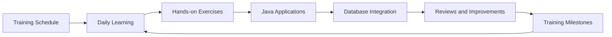

# Hexaware Training Journal

Private learning repository for tracking my Hexaware full-stack development training, exercises, database work, and daily progress.

## Training Path



## Current Project

This repository currently contains a Java 21 application that connects to MySQL using MySQL Connector/J.

```text
src/
└── com/
    ├── main/
    │   └── App.java
    └── utility/
        └── DBConnection.java
lib/
└── mysql-connector-j-9.1.0.jar
```

## Requirements

- Java 21
- MySQL Server running on `localhost:3306`
- MySQL database named `fsd_hex_sept_2026`
- MySQL Connector/J 9.1.0

## Run the Application

From the repository root in PowerShell:

```powershell
Remove-Item -Recurse -Force .\out -ErrorAction SilentlyContinue
New-Item -ItemType Directory .\out
javac -cp ".\lib\mysql-connector-j-9.1.0.jar" -d .\out .\src\com\utility\DBConnection.java .\src\com\main\App.java
java -cp ".\out;.\lib\mysql-connector-j-9.1.0.jar" com.main.App
```

Before running, create the database:

```sql
CREATE DATABASE fsd_hex_sept_2026;
```

## Training History

Daily training notes, schedules, exercises, and milestones will be added over time. Each meaningful learning milestone should be recorded with its date, topic, work completed, and follow-up action.

## Repository Information

- Owner: Kishore Muruganantham
- Training: Hexaware Technologies
- Language: Java
- Java version: 21
- Visibility: Private
