# Hexaware Training Journal

Private learning repository for tracking my Hexaware full-stack development training, exercises, database work, and daily progress.

## Training Path

```mermaid
flowchart LR
    A[Training Schedule] --> B[Daily Learning]
    B --> C[Hands-on Exercises]
    C --> D[Java Applications]
    D --> H[Java Fundamentals]
    H --> I[OOPs and Design Patterns]
    I --> J[Maven and JUnit]
    J --> K[Spring Core]
    K --> L[Hibernate and JPA]
    L --> M[Spring Boot REST]
    M --> E[Database Integration]
    E --> F[Reviews and Improvements]
    F --> G[Training Milestones]
    G --> B
```



## Current Project

This repository currently contains a Java 21 application that connects to MySQL using MySQL Connector/J.

The `JavaFundamentals` project contains the trainer's Java collections exercise. It uses enums for branch, department, and sort direction, stores sample employees in a DAO, sorts the list by salary with a lambda expression, filters by department and branch with streams, maps the model to response DTOs, groups employees by department and branch salary totals, and sorts with a default `Comparable` order. It also has the trainer's OOPs payment hierarchy demos, a singleton `DBConnection` shared by DAOs with a heap/stack demo, and a factory pattern payment demo.

```text
src/
└── com/
    ├── main/
    │   └── App.java
    ├── model/
    │   └── Employee.java
    ├── dao/
    │   └── CustomerDao.java
    ├── service/
    │   └── CustomerService.java
    └── utility/
        └── DBConnection.java
JavaFundamentals/
└── src/
    └── com/
        ├── main/
        │   ├── App.java
        │   ├── MapDemo.java
        │   ├── HeapDemo.java
        │   ├── IsADemo.java
        │   ├── NEFTPayment.java
        │   └── OOPDemo.java
        ├── model/
        │   └── Employee.java
        ├── beans/
        │   ├── Account.java
        │   ├── Current.java
        │   ├── Dmat.java
        │   ├── Savings.java
        │   ├── Payment.java
        │   ├── Neft.java
        │   ├── Upi.java
        │   └── Customer.java
        ├── dao/
        │   └── EmployeeDao.java
        ├── service/
        │   └── EmployeeService.java
        ├── enums/
        │   ├── Branch.java
        │   ├── Department.java
        │   ├── SortDirection.java
        │   └── PaymentMode.java
        ├── dto/
        │   ├── EmployeeRespDto.java
        │   ├── EmpDeptStatDto.java
        │   └── EmployeeSalaryStatDto.java
        ├── mapper/
        │   └── EmployeeMapper.java
        ├── utility/
        │   └── PaymentUtil.java
        ├── design_pattern/
        │   ├── App.java
        │   ├── DBConnection.java
        │   ├── CustomerDao.java
        │   ├── OrderDao.java
        │   └── ProductDao.java
        └── factory/
            └── design_pattern/
                ├── App.java
                ├── Payment.java
                ├── PaymentMode.java
                ├── PaymentFactory.java
                ├── Neft.java
                ├── RTGS.java
                ├── UPI.java
                ├── PhonePe.java
                ├── GooglePay.java
                └── PayTM.java
pl-sql.sql
lib/
└── mysql-connector-j-9.1.0.jar
MavenDemo/
├── pom.xml
└── src/
    ├── main/java/com/
    │   ├── service/
    │   │   ├── DemoService.java
    │   │   └── EmployeeService.java
    │   ├── model/
    │   │   └── Employee.java
    │   ├── dto/
    │   │   └── EmployeeRespDto.java
    │   ├── mapper/
    │   │   └── EmployeeMapper.java
    │   ├── enums/
    │   │   ├── Branch.java
    │   │   ├── Department.java
    │   │   └── SortDirection.java
    │   └── exception/
    │       ├── EmptyListException.java
    │       ├── InvalidInputException.java
    │       └── InvalidListException.java
    └── test/java/com/service/
        ├── DemoServiceTest.java
        └── EmployeeServiceTest.java
SpringCoreApp/
├── pom.xml
└── src/main/java/com/
    ├── config/
    │   └── AppConfig.java
    ├── main/
    │   ├── App.java
    │   ├── AppV2.java
    │   ├── AppV3.java
    │   ├── AppV4.java
    │   └── SpringApp.java
    ├── dao/
    │   └── MyDao.java
    ├── service/
    │   ├── MyService.java
    │   ├── MyServiceV2.java
    │   ├── MyServiceV3.java
    │   └── MyServiceV4.java
    ├── mapper/
    │   └── TestMapper.java
    └── utility/
        └── TestUtility.java
SpringCoreHelpDesk/
├── pom.xml
└── src/main/java/com/helpdesk/
    ├── config/
    │   └── AppConfig.java
    ├── main/
    │   └── App.java
    ├── model/
    │   ├── Customer.java
    │   ├── User.java
    │   └── Ticket.java
    ├── enums/
    │   ├── Plan.java
    │   ├── Priority.java
    │   ├── Status.java
    │   └── Role.java
    ├── repository/
    │   ├── CustomerRepository.java
    │   └── UserRepository.java
    ├── service/
    │   ├── CustomerService.java
    │   └── UserService.java
    ├── mapper/
    │   ├── TicketMapper.java
    │   └── UserMapper.java
    └── exception/
        └── InvalidCredentialsException.java
HibernateJpaApp/
├── pom.xml
└── src/main/java/com/helpdesk/
    ├── config/
    │   └── AppConfig.java
    ├── main/
    │   ├── App.java
    │   ├── ExecutiveController.java
    │   └── TicketController.java
    ├── dto/
    │   └── TicketRespDto.java
    ├── mapper/
    │   └── TicketMapper.java
    ├── model/
    │   ├── Customer.java
    │   ├── User.java
    │   ├── CustomerPlan.java
    │   ├── Executive.java
    │   ├── Manager.java
    │   ├── Plan.java
    │   └── Ticket.java
    ├── enums/
    │   ├── Role.java
    │   ├── JobTitle.java
    │   ├── PlanType.java
    │   ├── Priority.java
    │   └── Status.java
    ├── exception/
    │   └── ResourceNotFoundException.java
    ├── repository/
    │   ├── CustomerRepository.java
    │   ├── ExecutiveRepository.java
    │   ├── TicketRepository.java
    │   └── UserRepository.java
    └── service/
        ├── CustomerService.java
        ├── ExecutiveService.java
        └── TicketService.java
```

The `helpdesk.mwb` MySQL Workbench model from the trainer sits at the repository root next to the app.

`helpdesk_backend/` is the trainer's Spring Boot project (generated from start.spring.io, Boot 3.5.16, Java 21) with the customer POST API:

```text
helpdesk_backend/
├── pom.xml
├── mvnw
├── mvnw.cmd
└── src/
    ├── main/
    │   ├── java/com/springboot/helpdesk/
    │   │   ├── HelpdeskBackendApplication.java
    │   │   ├── controller/CustomerController.java
    │   │   ├── service/CustomerService.java
    │   │   ├── repository/CustomerRepository.java
    │   │   └── model/Customer.java
    │   └── resources/application.properties
    └── test/java/com/springboot/helpdesk/
        └── HelpdeskBackendApplicationTests.java
```

## Requirements

- Java 21
- MySQL Server running on `localhost:3306`
- MySQL database named `fsd_hex_sept_2026`
- MySQL Connector/J 9.1.0

## Run the Application

From the repository root in PowerShell:

```powershell
Remove-Item -Recurse -Force .\out -ErrorAction SilentlyContinue
New-Item -ItemType Directory .\out
javac -cp ".\lib\mysql-connector-j-9.1.0.jar" -d .\out .\src\com\utility\DBConnection.java .\src\com\main\App.java
java -cp ".\out;.\lib\mysql-connector-j-9.1.0.jar" com.main.App
```

The application calls the MySQL stored procedure `all_emp()`, maps each returned row to an `Employee`, and prints the employee list through the service layer.

It also supports parameterized department procedures:

- `emp_by_department(?)` returns complete employee records for a department.
- `emp_name_by_department(?)` is the trainer's next DAO exercise and remains a placeholder in the Java code.
- `cnt_emp_by_dept(?, ?)` returns the employee count through an OUT parameter.
- `trg_check_stock_qty` validates stock before an order is inserted.
- `trg_update_product_stock_qty` decreases product stock after an order is inserted.

Run `pl-sql.sql` in the `fsd_hex_sept_2026` database before using these procedures.

To run the Java fundamentals exercise (no database needed):

```powershell
Remove-Item -Recurse -Force .\out-fund -ErrorAction SilentlyContinue
New-Item -ItemType Directory .\out-fund
javac -d .\out-fund .\JavaFundamentals\src\com\enums\*.java .\JavaFundamentals\src\com\model\*.java .\JavaFundamentals\src\com\dao\*.java .\JavaFundamentals\src\com\dto\*.java .\JavaFundamentals\src\com\mapper\*.java .\JavaFundamentals\src\com\service\*.java .\JavaFundamentals\src\com\main\*.java
java -cp .\out-fund com.main.App
```

The application loads the sample employees from `EmployeeDao`, maps each one to an `EmployeeRespDto` with `EmployeeMapper`, and prints the DTO list. Sorting by salary, filtering by department and branch, and listing employee names are kept in the commented block in `App.java` as shown in the trainer's commit.

Other demo entry points in the same project:

```powershell
java -cp .\out-fund com.main.MapDemo
java -cp .\out-fund com.main.OOPDemo
java -cp .\out-fund com.main.IsADemo
java -cp .\out-fund com.main.HeapDemo
java -cp .\out-fund com.design_pattern.App
java -cp .\out-fund com.factory.design_pattern.App
```

`MapDemo` shows basic `HashMap` put, get, and entry-set printing. `OOPDemo` and `IsADemo` show the trainer's polymorphism and payment examples. `HeapDemo` shows heap references and the stack comment from the trainer. `com.design_pattern.App` shows the singleton `DBConnection` shared by the three DAOs. `com.factory.design_pattern.App` shows payment creation through `PaymentFactory`.

To run the Maven JUnit tests (needs Maven with the JUnit dependencies from `MavenDemo/pom.xml`):

```powershell
cd MavenDemo
mvn test
```

`DemoServiceTest` covers the demo service validations and exceptions, and `EmployeeServiceTest` covers the stream operations and DTO mapping. The main sources also compile with plain `javac` on Java 21 since they only use the JDK.

To run the Spring Core app (needs Maven with the Spring dependencies from `SpringCoreApp/pom.xml`):

```powershell
cd SpringCoreApp
mvn compile exec:java -Dexec.mainClass="com.main.App"
```

`App` through `AppV4` show context loading, bean injection, setter autowiring, in-method injection, and custom beans. `SpringApp` shows the `JdbcTemplate` query with the `HikariCP` datasource. The employee table needs the `joining_date` and `salary` columns from the updated `pl-sql.sql` before running the JDBC query.

The `SpringCoreHelpDesk` case study wires the same pieces into a helpdesk app: `App` signs up customers and fetches records through the repositories, services, `RowMapper`s, and `JdbcTemplate` (needs Maven, Spring jars, and MySQL).

To run the Hibernate app (needs Maven with the Hibernate and Spring dependencies from `HibernateJpaApp/pom.xml`):

```powershell
cd HibernateJpaApp
mvn compile exec:java -Dexec.mainClass="com.helpdesk.main.App"
```

`App` saves and fetches `Customer` records through `CustomerService` and the JPQL repository, with the session factory, transaction manager, and `DriverManagerDataSource` from `AppConfig` (needs Maven, Hibernate/Spring jars, and MySQL).

To run the Spring Boot backend (Maven comes through the `mvnw` wrapper, which downloads it on first run):

```powershell
cd helpdesk_backend
.\mvnw.cmd spring-boot:run
```

The app starts Tomcat on port 8080 using the `helpdesk_db` database (created automatically) with the datasource from `application.properties`. Security auto-configuration is excluded in the trainer's starter. Customer endpoints: `POST /api/customer/add` with raw JSON saves and returns the record with its generated id; `GET /api/customer/all` lists all records; `GET /api/customer/{id}` fetches one (`ResourceNotFoundException` for a bad id); `DELETE /api/customer/{id}` removes it.

Before running, create the database:

```sql
CREATE DATABASE fsd_hex_sept_2026;
```

## Training History

Daily training notes, schedules, exercises, and milestones will be added over time. Each meaningful learning milestone should be recorded with its date, topic, work completed, and follow-up action.

### 2026-09-21: Stored Procedure Employee Retrieval

- Added the `Employee` model with fields for ID, name, branch, city, and department.
- Added the `CustomerDao` data-access layer for calling `all_emp()`.
- Added the `CustomerService` layer for employee retrieval.
- Updated the application entry point to print all returned employees.
- Updated `DBConnection.dbConnect()` to return the active JDBC connection.

### 2026-09-22: Parameterized Department Procedures

- Added the trainer's validated `emp_by_department` and `emp_name_by_department` procedures.
- Added the trainer's parameterized `emp_by_department` JDBC call using `CallableStatement`.
- Added the trainer's `update_emp_branch` and `cnt_emp_by_dept` PL/SQL exercises.
- Kept `getEmployeeNamesByDepartment` as the trainer's placeholder method.
- Updated the application to demonstrate department-based retrieval.

### 2026-09-22: OUT Parameter and Views

- Added `getEmpCountByDept` using `CallableStatement` and an integer OUT parameter.
- Updated the application to display the employee count for the DEV department.
- Added the trainer's `v_emp` and `v_emp_dev` view examples with `WITH CHECK OPTION`.
- Commented the database connection status messages as shown in the trainer's commit.

### 2026-09-22: E-commerce Triggers

- Added the `product` and `orders` tables from the trainer's trigger case study.
- Added `trg_check_stock_qty` to reject invalid products and orders exceeding available stock.
- Added `trg_update_product_stock_qty` to reduce stock after a valid order.
- Added a valid sample order for product `1` with quantity `2`.

### 2026-09-22: E-commerce ER Model

- Added the MySQL Workbench model `ecom_sample.mwb`.
- Forward-engineered the `ecom_sample_db` schema with `users`, `customer`, `vendor`, `category`, `product`, and `customer_product`.
- Verified the six foreign-key relationships shown in the trainer's ER diagram.
- Prepared the forward-engineered SQL without the generated first three lines, last three lines, or `VISIBLE` keyword.

### 2026-09-23: Java Fundamentals Collections and DTO Mapping

- Added the `JavaFundamentals` project with `Branch`, `Department`, and `SortDirection` enums.
- Added the `Employee` model with branch, department, joining date, and salary fields.
- Added `EmployeeDao` with 20 sample employees.
- Added `EmployeeService` with salary sorting using a lambda expression, stream filters by department and branch, employee name listing, and model-to-DTO mapping.
- Added the `EmployeeRespDto` record and `EmployeeMapper` for model-to-DTO conversion.
- Added the `App` starter class which prints the DTO list; sorting, filtering, and name listing are kept in the commented block as shown in the trainer's commit.
- Added Java project metadata (`JavaFundamentals.iml`, `.idea` files, `.gitignore`) so `JavaFundamentals` opens as its own IntelliJ project.
- Verified with `javac` on Java 21 (BUILD_EXIT=0) and `java com.main.App` (RUN_EXIT=0); the app printed all 20 `EmployeeRespDto` records.
- MySQL server on `localhost:3306` was reachable; the fundamentals exercise itself does not need a database.
- Known issue: none; the salary sort uses the trainer's `(int)` cast comparison.

### 2026-09-24: Grouping, DTO Stats, Comparable, and OOPs

- Added `EmpDeptStatDto` and `getEmpCountForEachDepartment` grouping with `Collectors.groupingBy` and `Collectors.counting`.
- Added `MapDemo` with the trainer's `HashMap` login example.
- Converted the department count to a `List<EmpDeptStatDto>` through entry-set mapping.
- Added `EmployeeSalaryStatDto`, `getSalaryOfEachEmpByBranch` with `Collectors.summingDouble`, and `computeTotalSalary`.
- Added `Comparable` to `Employee` with joining-date default sort and sorted retrieval in `getAllEmployees`.
- Added the trainer's OOPs payment hierarchy (`Account`, `Savings`, `Current`, `Dmat`, `Payment`, `Neft`, `Upi`), `PaymentMode` enum, `PaymentUtil`, and the `OOPDemo`, `IsADemo`, and `NEFTPayment` starters.
- Verified with `javac` on Java 21 (BUILD_EXIT=0); `App` printed the department stats, branch salary stats, and total salary 1680000.0; `MapDemo`, `OOPDemo`, and `IsADemo` ran (RUN_EXIT=0).
- Known issue: none; kept the trainer's style and comments as shown.

### 2026-09-25: Singleton and Factory Patterns

- Added the `Customer` bean and the trainer's singleton `DBConnection` shared by `CustomerDao`, `OrderDao`, and `ProductDao` in `com.design_pattern`.
- Added `HeapDemo` showing heap object references and the trainer's stack and garbage-collector comments.
- Added the trainer's factory pattern in `com.factory.design_pattern` (`Payment`, `PaymentMode`, `PaymentFactory`, `Neft`, `RTGS`, `UPI`, `PhonePe`, `GooglePay`, `PayTM`) with its `App` starter.
- Verified with `javac` on Java 21 (BUILD_EXIT=0); `HeapDemo`, `com.design_pattern.App` (same connection instance in all DAOs), and `com.factory.design_pattern.App` (charge 10.0, limit 200000.0) ran (RUN_EXIT=0).
- Known issue: none; kept the trainer's style and comments as shown.

### 2026-09-28: Maven and JUnit Tests

- Added the `MavenDemo` Maven project with JUnit dependencies in `pom.xml`.
- Added `DemoService` with validations and custom exceptions (`EmptyListException`, `InvalidInputException`, `InvalidListException`).
- Added `DemoServiceTest` test cases for validations and exceptions.
- Added stream test cases with `EmployeeService`, `Employee` model, enums, and `EmployeeServiceTest`.
- Added DTO test case with `EmployeeRespDto`, `EmployeeMapper`, and mapper coverage in the tests.
- Verified `pom.xml` is well-formed and all main sources compile with `javac` on Java 21 (MAIN_BUILD_EXIT=0).
- Test execution needs Maven and the JUnit jars, which are not installed in this environment, so `mvn test` could not be run here.
- Known issue: none; kept the trainer's style and comments as shown.

### 2026-09-29: Spring Core Dependency Injection

- Added the `SpringCoreApp` Maven project with Spring dependencies in `pom.xml`.
- Added `AppConfig` with component scanning and context loading in `App`.
- Added `MyDao` and `MyService` beans to the context.
- Added setter autowiring variants (`AppV2`, `AppV3`, `MyServiceV2`, `MyServiceV3`) with `TestMapper` and `TestUtility`.
- Added in-method direct injection (`AppV4`, `MyServiceV4`) and a custom bean definition.
- Added `HikariCP` datasource and `JdbcTemplate` config with the `SpringApp` starter.
- Extended `pl-sql.sql` with `joining_date` and `salary` columns, seed values, and department `GROUP BY` queries in the existing file style.
- Verified `pom.xml` is well-formed; `javac` on Java 21 reports only missing Spring/HikariCP package errors (60 errors, all `package does not exist` or cascading symbols), with no syntax errors.
- Running needs Maven, the Spring jars, and MySQL with the updated employee table, so the app could not be run here.
- Known issue: none; kept the trainer's style and comments as shown.

### 2026-09-30: HelpDesk Case Study

- Added the `SpringCoreHelpDesk` Maven project with models (`Customer`, `User`, `Ticket`), enums (`Plan`, `Priority`, `Status`, `Role`), repositories, and services.
- Added customer sign-up insertion through the service and repository layers.
- Added fetch operations with `TicketMapper`, `UserMapper`, and `InvalidCredentialsException`.
- The trainer's `Case Study_spring-core.pdf` was left out as reference material.
- Verified `pom.xml` is well-formed; `javac` on Java 21 reports only missing Spring/HikariCP package errors, with no syntax errors.
- Running needs Maven, Spring jars, and MySQL, so the app could not be run here.
- Known issue: none; kept the trainer's style and comments as shown.

### 2026-10-01: Hibernate and JPA Entities

- Added the `HibernateJpaApp` Maven project with Hibernate and Spring dependencies in `pom.xml`.
- Added `AppConfig` with the entity manager factory, transaction manager, and datasource.
- Added the `Customer` entity with insert and fetch through `CustomerRepository` (JPQL) and `CustomerService`.
- Added the `User` model with the `Role` enum.
- Added all helpdesk entities (`CustomerPlan`, `Executive`, `Manager`, `Plan`, `Ticket`) with enums (`JobTitle`, `PlanType`, `Priority`, `Status`).
- Verified `pom.xml` is well-formed; `javac` on Java 21 reports only missing JPA/Spring/Hibernate package errors, with no syntax errors.
- Running needs Maven, Hibernate/Spring jars, and MySQL, so the app could not be run here.
- Known issue: none; kept the trainer's style and comments as shown.

### 2026-10-05: Executive Insert

- Added `ExecutiveService` with `insertExecutive` carrying the trainer's four step comments (prepare user, fetch manager, attach both to executive, pass to repository).
- Added `ExecutiveRepository` and the `ExecutiveController` starter, which prepares a manager id, an executive, and login details and calls the service.
- Restructured the datasource bean in `AppConfig` to the trainer's constructor style against `helpdesk_v2`.
- Added the trainer's `helpdesk.mwb` Workbench model at the repository root.
- Verified with `javac` on Java 21: only missing JPA/Spring/Hibernate package errors, with no syntax errors; new files are byte-identical to the trainer's.
- Running needs Maven, Hibernate/Spring jars, and MySQL, so the app could not be run here.
- Known issue: none; kept the trainer's style and comments as shown.

### 2026-10-05: Executive Insert With User Flow

- Implemented the full `insertExecutive` flow: validate the manager id through `ExecutiveRepository.getManagerById` with `ResourceNotFoundException`, persist the `User`, re-fetch the complete user row with the JPQL `getUserByUsername` query, attach user and manager to the executive, and persist it.
- Added `UserRepository` with `insert` and `getUserByUsername`, `ResourceNotFoundException`, and the `User`/`Executive` model updates.
- Verified with `javac` on Java 21: only missing JPA/Spring/Hibernate package errors, with no syntax errors; all 7 touched files byte-identical to the trainer's commit.
- Running needs Maven, Hibernate/Spring jars, and MySQL, so the app could not be run here.
- Known issue: none; kept the trainer's style and comments as shown.

### 2026-10-05: Ticket Creation With Customer

- Added `TicketService` with step-commented `insertTicket`: fetch the customer by id (invalid id throws `ResourceNotFoundException`), prepare the ticket with `OPEN` status, attach the customer, and persist it.
- Added `TicketRepository` and the `TicketController` starter, which files an "Internet shutdown" ticket for customer id `1`.
- Extended `CustomerRepository` with `getCustomerById` and updated `UserRepository`, `Ticket`, `ExecutiveService`, `App`, and `ExecutiveController` as shown in the trainer's commit.
- Seeded the demo row in the `helpdesk_v2` database with the trainer's statement before running:

  ```sql
  insert into customer(city,name) values ('london','harry potter');
  ```
- Verified with `javac` on Java 21: only missing JPA/Spring/Hibernate package errors, with no syntax errors; all 9 touched files byte-identical to the trainer's commit.
- Running needs Maven, Hibernate/Spring jars, and MySQL, so the app could not be run here.
- Known issue: none; kept the trainer's style and comments as shown.

### 2026-10-05: Ticket Fetch With DTO

- Added `TicketRespDto` and `TicketMapper` converting ticket entities (customer name/username, executive id/job title) to DTOs.
- Added `fetchTicketInfoV1` (all tickets) and the `fetchTicketInfoV2` join-query placeholder in `TicketRepository`.
- Added `fetchTicketInfo` in `TicketService` mapping the ticket list to DTOs; `TicketController` now demos the fetch instead of the insert.
- Updated `Customer`, `Ticket`, and related layers as shown in the trainer's commit.
- Verified with `javac` on Java 21: only missing JPA/Spring/Hibernate package errors, with no syntax errors; all 7 touched files byte-identical to the trainer's commit.
- Running needs Maven, Hibernate/Spring jars, and MySQL, so the app could not be run here.
- Known issue: none; kept the trainer's style and comments as shown.

### 2026-10-06: Spring Boot Customer POST API

- Added the trainer's `helpdesk_backend` Spring Boot project (Boot 3.5.16, Java 21, Maven wrapper) with Web, Data JPA, MySQL, Security, Lombok, and Validation starters.
- Added `Customer` entity (Lombok + JPA), `CustomerRepository` (`JpaRepository`), `CustomerService`, and `CustomerController` with `POST /api/customer/add` returning the saved record with its generated id.
- Added `application.properties` with the `helpdesk_db` datasource (auto-created) and `ddl-auto=update`; security auto-configuration is excluded in the starter.
- Verified with the `mvnw` wrapper: Maven bootstrapped, project compiles, app booted with Tomcat on port 8080, and `POST /api/customer/add` with raw JSON returned HTTP 200 plus the saved record with its generated id.
- Known issue: none; kept the trainer's style and comments as shown.

### 2026-10-06: Customer CRUD APIs

- Added `GET /api/customer/all`, `GET /api/customer/{id}`, and `DELETE /api/customer/{id}` to the controller with `getAll`, `getById`, and `deleteById` in the service using the free `JpaRepository` methods.
- Added `ResourceNotFoundException` thrown for an invalid customer id.
- Exercised all four endpoints live: `GET /all` returned 200 with 5 records, `GET /1` returned 200 with the record, `POST` returned 200 with the new record, `DELETE /1` returned 200 with an empty body, and `GET /1` afterwards returned the trainer's exact 500 JSON because the exception carries no status mapping — kept exactly as he wrote it.
- Known issue: none in code; the 500 on missing ids is his implementation as shown.

### 2026-10-06: Global Handler for Invalid IDs

- Added `GlobalExceptionHandler` (`@ControllerAdvice`) mapping `ResourceNotFoundException` to 400 with the message body, kept exactly as he wrote it.
- `deleteById` now validates through `getById` first, so deleting a missing id throws instead of silently passing.
- Exercised live after reboot: `GET /all` 200, `GET /3` 200 with the record, `GET /1`, `GET /2`, and `DELETE /999` (all missing) each return 400 with `Invalid customer id`, and `DELETE /3` returns 200 empty. The old 500 JSON is gone.
- Known issue: none; kept the trainer's style and comments as shown.

### 2026-10-06: Error DTO Response

- Added `ErrorDto` record (`message`, `comments`, `timestamp`) fulfilling his own "always reply the object not the string" comment; the handler now returns the DTO with 400 and `"Id not found in DB"`.
- Rebooted and verified live: `GET /1` returns 400 with `{"message":"Invalid customer id","comments":"Id not found in DB","timestamp":"..."}`, and `GET /all` still returns 200 with the records.
- Known issue: none; kept the trainer's style and comments as shown.

## Repository Information

- Owner: Kishore Muruganantham
- Training: Hexaware Technologies
- Language: Java
- Java version: 21
- Visibility: Private
